# CPS-1 vs Mega Drive: architecture research

Groundwork for porting *Cadillacs and Dinosaurs* (Capcom, 1993, MAME set `dino`) from the CP System to the Sega Mega Drive. This document compares the two machines and records what the arcade program actually does with its hardware. The port plan builds on it.

Facts come from three places, and the text says which:

- **ROM** — measured by us from the `dino` ROM set (disassembly and byte scans of the program, graphics and sample ROMs).
- **MAME / docs** — read from MAME's source, jotego's FPGA core notes, SGDK headers, plutiedev and similar; links are in [Sources](#sources).
- **Unverified** — recalled or second-hand; collected in [Open questions](#open-questions).

## Target

The goal is a port that is as close to arcade-perfect as the Mega Drive allows, using the kind of techniques Final Fight MD used to get around the console's limits. The bar, per area:

| Area | Target | Hard limit that applies |
|---|---|---|
| Gameplay and input | Identical to the arcade: same logic, timing and response, three players | None, if the arcade code runs; CPU time is the risk |
| Frame rate | 60 fps like the arcade | About 55–64% of the arcade's CPU time per frame |
| Graphics | All arcade art, animation frames and effects; nothing cut | 320 px width; 80 sprites, 320 sprite pixels per line; pattern upload budget |
| Colour | As close to the arcade palette as possible in every scene | 61 colours on screen from 512, against up to 1,920 from 65,536 |
| Sound | Full soundtrack, effects and voices | FM + PSG + software-mixed PCM in place of 16-voice QSound |

Gameplay, input and content can match the arcade. Colour depth, screen width and the sound chip cannot be matched exactly on stock hardware; there the target is the best achievable approximation, judged side by side with the arcade.

## 1. Summary

| | CPS-1 (`dino`, CP System Dash) | Mega Drive (NTSC) | Consequence |
|---|---|---|---|
| Main CPU | 68000 at 12 MHz (MAME; some sources say 10) | 68000 at 7.67 MHz | Same instruction set. The game code can run natively, with about 64% of the clock |
| Work RAM | 64 KB at `0xFF0000` | 64 KB at `0xFF0000` | Same size, same address |
| Video RAM | 192 KB "GFX RAM", directly memory-mapped | 64 KB VRAM behind VDP ports | No direct access; everything goes through a port or DMA |
| Tile graphics | Read straight from 4 MB of ROM by the video hardware | Must be copied into VRAM (about 1,600 8×8 patterns fit) | The largest gap: a tile streaming and caching engine is required |
| Resolution | 384×224 at 59.64 Hz | 320×224 at 59.92 Hz | 64 pixels of width are lost |
| Tile layers | 3 (8×8, 16×16, 32×32 tiles), each 64×64 tiles | 2 planes (8×8 cells) plus a non-scrolling window | One layer has to be folded into something else |
| Sprites | 256 entries, each a block of up to 16×16 tiles; no per-line limit found | 80 sprites of up to 32×32 px; 20 per line, 320 px per line | Sprite merging, culling and flicker management |
| Colours | 3,072 palette entries (192 palettes of 16), 12-bit RGB plus 4-bit brightness | 64 entries (4 palettes of 16), 9-bit RGB | Offline colour reduction per scene |
| Sound | Z80 at 8 MHz driving a QSound DSP: 16 PCM voices, 2 MB of samples | Z80 at 3.58 MHz driving YM2612 (6 FM, one usable as 8-bit DAC) and PSG | The soundtrack has to be rearranged for FM; no sample playback hardware |
| ROM | 1.5 MB program, 4 MB graphics, 2 MB samples, 128 KB Z80 | 4 MB flat; more with the Sega mapper (512 KB banks) | A mapper cartridge in the 8 MB class |
| Players | 3, two buttons each | 2 ports; 3+ with a multitap | Team Player / 4-Way Play support for the third player |
| Settings | 93C46 EEPROM | Battery SRAM (optional) | Small replacement |

The CPU match is what makes the project plausible. Everything else on the list is a hardware layer that must be replaced.

### 1.1 How much of the arcade the Mega Drive has

Each bar is the Mega Drive figure as a percentage of the CPS-1 figure for the same resource.

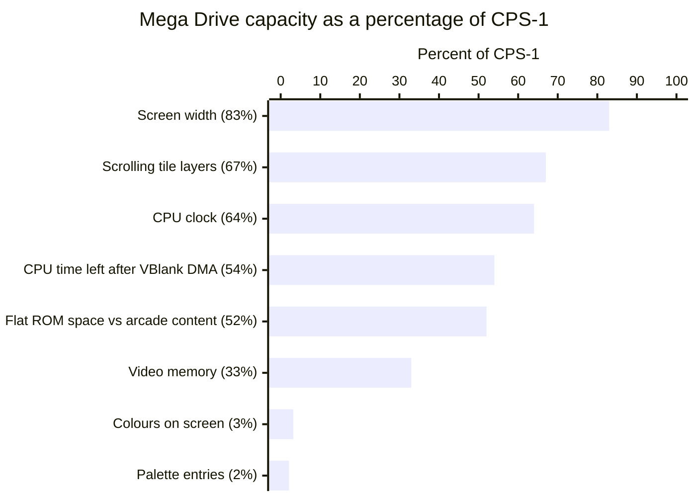

| Resource | CPS-1 (`dino`) | Mega Drive | Ratio |
|---|---|---|---|
| Screen width | 384 px | 320 px | 83% |
| Scrolling tile layers | 3 | 2 | 67% |
| CPU clock | 12 MHz | 7.67 MHz | 64% |
| CPU cycles per frame, after a full VBlank DMA | about 201,000 | about 109,000 | 54% |
| ROM space without a mapper, against arcade content | 7.6 MB of content | 4 MB | 52% |
| Video memory | 192 KB | 64 KB | 33% |
| Colours on screen | 1,920 | 61 | 3% |
| Palette entries | 3,072 | 64 | 2% |

The first five are shortfalls of a third to a half, the kind that optimisation and a mapper can absorb. Colour is a different order of magnitude, which is why it needs offline work per scene and cannot be solved at run time.

### 1.2 Block diagrams

**CPS-1 (CP System Dash, as used by `dino`).** The 68000 sees its video tables as ordinary memory, and the video chips read pixel data from ROM on their own.

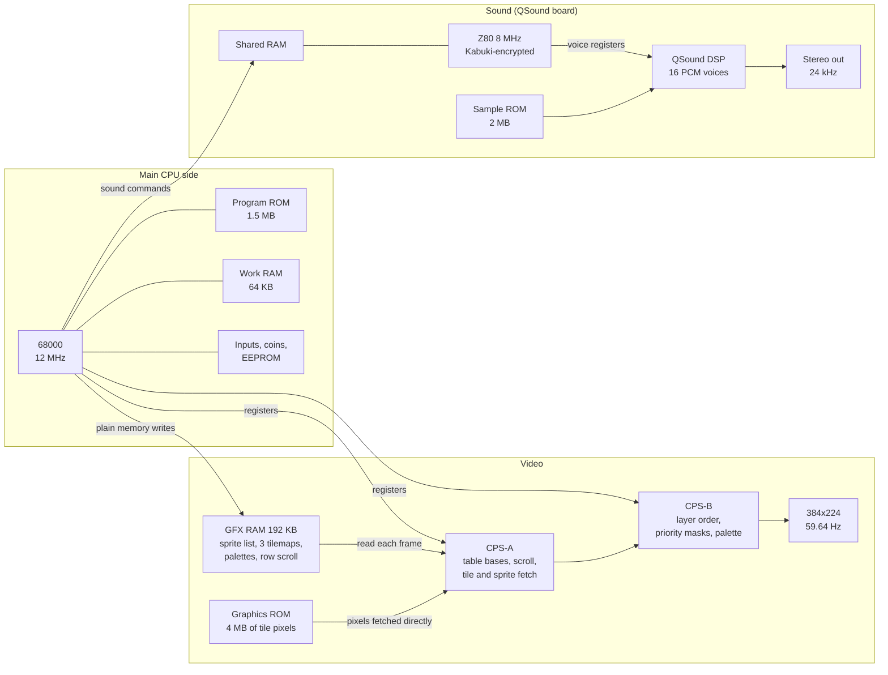

**Mega Drive.** The VDP owns its memory. The 68000 reaches it only through ports or DMA, and tile pixels must be copied into VRAM before they can be shown.

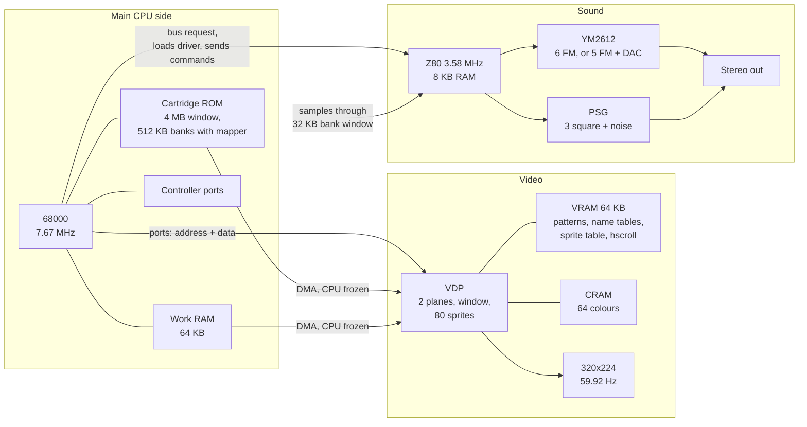

## 2. CPU and code execution

### 2.1 The same processor

Both machines use a Motorola 68000 with no MMU and no cache. Instructions, addressing modes, the exception model and the supervisor/user split are identical. Machine code from the arcade ROM is valid Mega Drive code as long as it does not touch hardware addresses.

Speed is the difference:

| | CPS-1 | Mega Drive NTSC |
|---|---|---|
| Clock | 12 MHz in MAME's `qsound` machine config | 53.693175 MHz / 7 = 7.670454 MHz |
| Cycles per frame | about 201,000 | about 128,000 |
| Lost to video transfers | none (video RAM is plain memory) | a full-VBlank DMA freezes the CPU for about 38 lines, leaving about 109,000 |

So the Mega Drive has roughly 55–64% of the arcade's CPU time per frame, and the hardware layer we add also has to run inside that budget. Slowdown in busy scenes is a real risk; a 30 fps fallback under load (as Final Fight MD offers) is the usual answer.

These ratios compare capacity, not need: they only matter to the extent the arcade program uses its frame. Measured on Final Fight, the arcade's game work takes 56% of a 10 MHz frame on average and would fit a Mega Drive frame with about a quarter to spare ([doc 02, section 2.2](02-final-fight-arcade-vs-md.md#22-how-busy-the-arcade-cpu-is)). The same measurement for Cadillacs and Dinosaurs is pending.

### 2.2 Memory maps

| Range | CPS-1 (`dino`) | Mega Drive |
|---|---|---|
| `0x000000`– | Program ROM, 1.5 MB used (`0x000000–0x17FFFF`) | Cartridge ROM, 4 MB (`0x000000–0x3FFFFF`) |
| `0x800000`–`0x80003F` | Player inputs, coins, DIP/system, coin control | Unused; access hangs the machine (32X area) |
| `0x800100`–`0x80013F` | CPS-A registers (video bases and scroll) | — |
| `0x800140`–`0x80017F` | CPS-B registers (layer order, priority masks, palette control) | — |
| `0x900000`–`0x92FFFF` | GFX RAM: sprite list, tilemaps, palettes, row scroll | — |
| `0xA00000`–`0xA0FFFF` | — | Z80 address space (YM2612 at `0xA04000`) |
| `0xA10000`–`0xA1001F` | — | Controller ports |
| `0xA11100`, `0xA11200` | — | Z80 bus request and reset |
| `0xA130F1`–`0xA130FF` | — | Mapper bank registers and SRAM control |
| `0xC00000`–`0xC00011` | — | VDP data and control ports, PSG |
| `0xF18000`–`0xF19FFF` | QSound shared RAM (odd bytes) | — |
| `0xF1C000`–`0xF1C007` | Player 3 input, coin control 2, EEPROM | — |
| `0xFF0000`–`0xFFFFFF` | Work RAM, 64 KB | Work RAM, 64 KB |

Two things line up well:

- Work RAM is at the same address and the same size, so every RAM reference in the game is already correct.
- The program sits at address 0 on both. The Mega Drive needs its own header at `0x100–0x1FF` and its own vector table, which overlap arcade code and data in that region, so the first 512 bytes need relocating or patching.

The problem is the same fact seen from the other side: the game uses all 64 KB of work RAM as its own, and on the arcade its video data lives in a separate 192 KB. On the Mega Drive the port's own state (shadow tables, tile cache bookkeeping, DMA queue) has to come out of that same 64 KB. Finding out how much of the 64 KB the game really uses is an early task.

### 2.3 Boot and interrupts

| | CPS-1 (`dino`) | Mega Drive |
|---|---|---|
| Reset | Vector 0: SSP `0xFF0E66`, PC `0x00041A` (**ROM**) | Vector 0 SSP, vector 1 PC; then TMSS write (`'SEGA'` to `0xA14000`), Z80 and VDP initialisation |
| VBlank | Level 2 autovector → `0x000542` (**ROM**) | Level 6 autovector |
| Other IRQs | Level 4 exists for a CPS-B raster interrupt; `dino` points it at a dummy handler (**ROM**) | Level 4 HBlank (programmable line counter), level 2 external |
| Acknowledge | Automatic on the IACK cycle | Automatic on the IACK cycle |

`dino` uses exactly one hardware interrupt. On the Mega Drive its handler moves from the level 2 vector to level 6. The interrupt mask values the game writes to SR (`0x2000`, `0x2600`) still work: `0x2600` masks level 6 and below, so "interrupts off" still means off.

### 2.4 How the game program runs (measured from the ROM)

**Reset (`0x41A`).** Sets `A5 = 0xFFFF8000`, clears work RAM, programs the video registers, then jumps into kernel start-up.

**Global base register.** `A5` is the base for all globals: the code addresses work RAM as `(d16,A5)`, reaching `0xFF0000–0xFFFFFF`. Nearly every routine depends on it.

**A multitasking kernel.** The game is not one big loop. It runs a small cooperative kernel:

- 16 task slots of 16 bytes each at `0xFF0052` (state, sleep counter, saved SR, saved PC, saved USP, stack base).
- 16 task stacks of 192 bytes, listed in a table at ROM `0x502`.
- Tasks run in **user mode**; the kernel and the VBlank handler run in supervisor mode.
- Tasks call the kernel with TRAP instructions:

| Trap | Handler | Meaning (our reading) |
|---|---|---|
| `TRAP #0` | `0x8DA` | Create a task in slot D0 at entry A0 |
| `TRAP #1` | `0x912` | Exit the current task |
| `TRAP #2` | `0x93A` | Kill the task in slot D0 |
| `TRAP #3` | `0x974` | Sleep for D0 frames |
| `TRAP #4` | `0x9C2` | Yield until the next frame |
| `TRAP #5`, `#6` | `0x9EA`, `0xA06` | Suspend / resume a slot |
| `TRAP #7` | `0xA18` | Restart the current task at A0 |
| `TRAP #12` | `0xA2E` | Raise or lower the interrupt mask |

- The scheduler at `0x83C` walks the slots over and over, resuming each runnable task with `RTE`. A task that yields is runnable again on the next pass; a task that sleeps becomes runnable when the VBlank handler has counted its timer down, which is what ties the game to the frame rate.

None of this touches CPS-1 hardware. It uses only standard 68000 features, all of which the Mega Drive has, so the kernel should run unchanged.

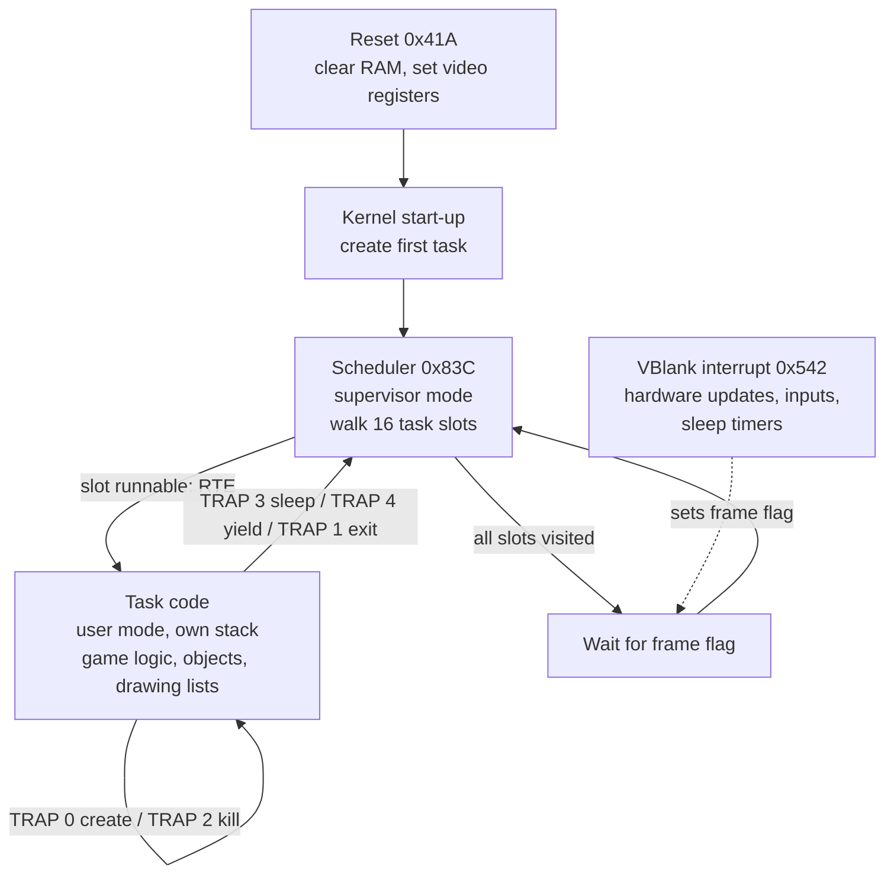

**The VBlank handler (`0x542`).** Once per frame it:

1. Flips the sprite list between two buffers (`0x900000` and `0x904000`). The game double-buffers its sprite list.
2. Rewrites the CPS-A base registers from shadow copies in work RAM.
3. Writes palette control and palette base, which makes the hardware copy the palette.
4. Sends queued sound commands to the QSound shared RAM.
5. Writes the three layers' scroll registers from shadows.
6. Reads and debounces the inputs into work RAM.
7. Decrements sleeping tasks' timers and sets the frame flag.

This handler is the single place where most hardware registers are written, which makes it the natural seam for a replacement.

One arcade frame, in order:

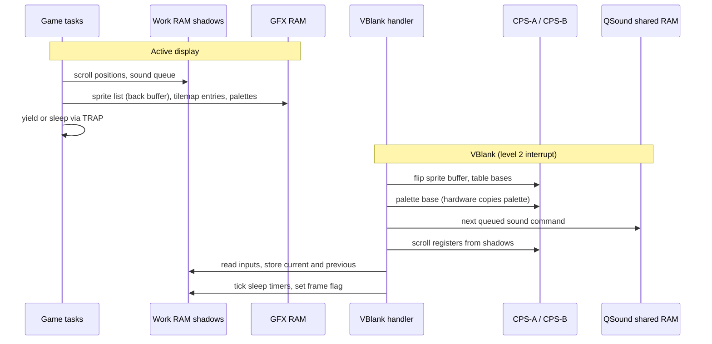

**Function calls.** The code is hand-written assembly: about 6,300 `JSR` to absolute addresses, about 8,700 `BSR`-style branches and about 4,000 `RTS` (byte-pattern counts from the ROM, so approximate). Arguments are passed in registers, not on the stack. Registers have fixed roles: `A5` global base, `A6` the current object. Jump tables indexed by state bytes are common (per the hack-scene disassembly notes). This differs from C code built with SGDK's GCC, which pushes arguments on the stack and treats `d0/d1/a0/a1` as scratch. Any new C code called from arcade code needs glue that saves registers and keeps `A5`/`A6` intact; writing the new hardware layer in assembly avoids the mismatch.

**How tightly the code is tied to the hardware.** Scanning the program for absolute addresses (**ROM**, approximate because data can look like addresses):

- About 2,100 references into GFX RAM (`0x900000–0x92FFFF`), spread over the sprite buffers, all three tilemaps and the palette area.
- About 50 references to CPS-A/CPS-B registers, almost all in reset and the VBlank handler.
- About 50 references to the QSound shared RAM, player 3 and EEPROM ports.

More GFX RAM access happens through address registers and will not show up in that count. The direct references are too many to rewrite by hand one at a time, which shapes the strategy in [section 8](#8-what-this-means-for-the-port).

## 3. Rendering on the CPS-1

### 3.1 Model

The CPS-1 video system has no pattern memory. The game writes *lists* into GFX RAM (which tile goes where), and the video hardware fetches pixel data directly from the graphics ROMs while drawing. Any of the roughly 32,000 16×16 tiles in the ROM can be on screen at any time at no cost.

- Pixel clock 8 MHz, 512×262 total, 384×224 visible, 59.637 Hz (MAME).
- GFX RAM is ordinary memory for the 68000: 192 KB at `0x900000`. The game chooses where each table lives by writing base registers.

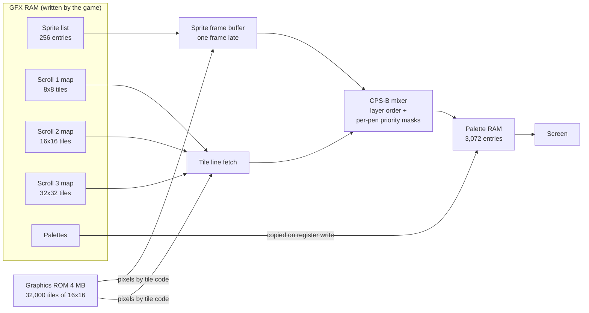

`dino`'s layout (**ROM**, matches MAME traces):

| Table | Address | Size |
|---|---|---|
| Sprite list, buffer A / B | `0x900000` / `0x904000` | 256 entries × 8 bytes |
| Scroll 1 tilemap (8×8 tiles) | `0x908000` | 16 KB |
| Scroll 2 tilemap (16×16 tiles) | `0x90C000` | 16 KB |
| Scroll 3 tilemap (32×32 tiles) | `0x910000` | 16 KB |
| Palettes | `0x914000` | 4 pages in use |
| Row scroll table | `0x915800` | 2 KB |

### 3.2 Tile layers

| Layer | Tile size | Map size | Pixel size | Used in `dino` for (per hack notes) |
|---|---|---|---|---|
| Scroll 1 | 8×8 | 64×64 | 512×512 | HUD and text |
| Scroll 2 | 16×16 | 64×64 | 1024×1024 | Floor / playfield |
| Scroll 3 | 32×32 | 64×64 | 2048×2048 | Background |

- Each map entry is two words: a 16-bit tile code, then attributes (5-bit palette, flip X, flip Y, 2-bit priority group).
- Maps are stored column by column, not row by row.
- Scroll 2 supports per-line horizontal offsets (row scroll).
- Layer order is programmable. `dino` writes `0x12D6` to the layer control register, which decodes to (back to front): scroll 3, scroll 2, sprites, scroll 1.
- Tile-over-sprite priority: four 16-bit masks in CPS-B. A tile's priority group picks a mask; pens set in the mask are drawn in front of sprites. This is per *colour index*, so one tile can be partly in front of and partly behind a sprite.

### 3.3 Sprites

- 256 entries per frame: X, Y, tile code, attributes. A byte of `0xFF` in the attribute marks the end.
- Each entry can be a block of up to 16×16 tiles of 16×16 pixels, taken from a 16-tile-wide sheet, so a whole character can be one or two entries. Final Fight hardly uses this (see [doc 02](02-final-fight-arcade-vs-md.md)); how much Cadillacs and Dinosaurs does is still to be measured.
- Earlier entries are drawn on top.
- The hardware renders sprites into a frame buffer, so there is no per-scanline sprite limit in the sources we read, and sprites appear one frame after the tile layers.
- No per-sprite priority bit; ordering against tiles comes from the layer order and the priority masks.

### 3.4 Colour

- Palette entry: 4 bits brightness, 4 red, 4 green, 4 blue.
- 6 pages × 32 palettes × 16 colours. Each layer type has its own page: sprites, scroll 1, scroll 2, scroll 3 (and two unused star-field pages). Pen 15 is transparent.
- So each of the four layers can show 32 different 15-colour palettes at once: up to 1,920 colours on screen.
- The 68000 writes palettes into GFX RAM; the hardware copies them to the real palette RAM when the palette base register is written. `dino` does this every VBlank.

### 3.5 Graphics ROM

- 4 MB, 4 bits per pixel, planar. A 16×16 tile is 128 bytes; 8×8 tiles use 64-byte slots; 32×32 tiles use 512 bytes.
- The same ROM space serves all layers; a PAL (`CD63B`) maps tile codes to two 2 MB banks.
- **ROM:** of 32,768 16×16-sized slots, 32,002 hold distinct non-blank data. The graphics ROM is essentially full, with no duplication at the 16×16 level.

## 4. Rendering on the Mega Drive

### 4.1 Model

The VDP draws from its own 64 KB of VRAM, which holds *both* the tile pixels and the tables. The 68000 cannot address VRAM; it sends an address and data through ports at `0xC00000`, or asks the VDP to pull a block from ROM/RAM by DMA. Rendering is line by line with fixed per-line limits.

- H40 mode: 320×224, 262 lines, 59.92 Hz NTSC. There is no 384-wide mode.
- Pattern: 8×8 pixels, 4 bpp, 32 bytes.

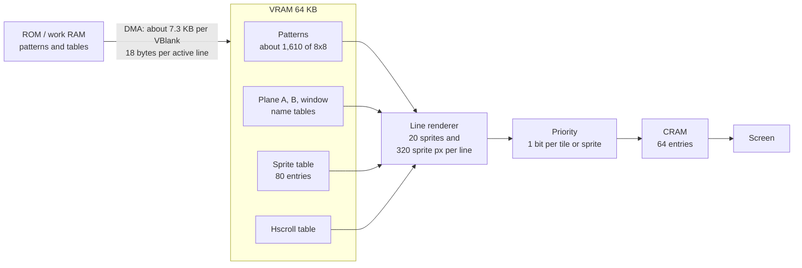

### 4.2 VRAM budget

| Item | Bytes |
|---|---|
| Plane A name table (64×32) | 4,096 |
| Plane B name table (64×32) | 4,096 |
| Window name table | 4,096 |
| Sprite attribute table | 640 |
| Horizontal scroll table (per-line) | 960 |
| **Left for patterns** | **about 51.6 KB ≈ 1,610 patterns** |

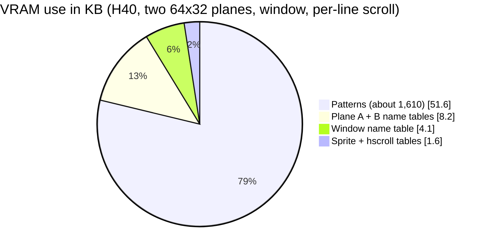

1,610 patterns is about 400 tiles of 16×16, shared between both planes and all sprites. For scale: one screen of CPS-1 scroll 3 (32×32 tiles, about 12×7 visible) is up to 1,344 patterns if every tile is distinct, which alone would nearly fill VRAM.

### 4.3 Planes

- Two scrolling planes, A and B, of the same size (up to 64×64 or 128×32 cells).
- Name table entry: priority bit, 2-bit palette, flip V, flip H, 11-bit pattern index. Stored row by row.
- Horizontal scroll: whole plane, per 8-pixel row, or per scanline. Vertical scroll: whole plane or per 16-pixel column.
- The window replaces plane A in a region anchored to the screen edges and does not scroll.
- Priority order, back to front: backdrop, B low, A low, sprites low, B high, A high, sprites high. Priority is one bit per *tile* or per sprite, not per colour.

### 4.4 Sprites

- 80 sprites per frame in H40, each 1–4 cells wide and high (up to 32×32 px), chained by a link field that also sets draw order.
- Per scanline: 20 sprites and 320 sprite pixels. Excess sprites are dropped on that line, last in link order first.
- Sprite patterns come from the same VRAM as plane patterns.

Rough sizing for this game (our estimate): a 64×96 px character is 24 CPS-1 tiles and six 32×32 Mega Drive sprites. With 80 sprites that is about 13 such characters before anything else is drawn, and five characters standing in a row reach the 320 px per-line limit.

### 4.5 Colour

- 64 CRAM entries: 4 palettes of 16, 3 bits per channel (512 colours). Colour 0 of each palette is transparent, so 61 are usable.
- Planes and sprites share the same 4 palettes.
- Shadow/highlight mode can add darker and brighter variants, with restrictive rules.
- Palettes can be changed mid-frame from an HBlank interrupt (for example a different palette set for the HUD band), at the cost of some CPU time and possible stray dots.

### 4.6 The transfer budget

This is the constraint with no arcade counterpart.

| | Bytes to VRAM (NTSC, H40) |
|---|---|
| Per scanline, display active | 18 |
| Per scanline, blanking | about 200 (sources give 198–205) |
| DMA during VBlank, per frame | about 7,200–7,500 |

- About 7.3 KB per frame is about 230 patterns, or about 57 CPS-1 16×16 tiles, per frame. The sprite table (640 bytes) and any name table or scroll updates come out of the same budget.
- The 68000 is frozen while a ROM/RAM-to-VRAM DMA runs.
- Blanking extra lines at the top and bottom of the screen buys about 200 bytes per line (16 lines add about 3.2 KB), at the cost of picture height.
- DMA source data must not cross a 128 KB boundary and, with a mapper, must be banked in when the transfer runs.

A new enemy type walking on screen, or a fast scroll into fresh background, can need more new patterns than one frame can deliver. The engine has to spread uploads over several frames and decide what to show meanwhile.

## 5. The rendering gap

| Arcade behaviour | Mega Drive reality | Direction |
|---|---|---|
| Game writes tile codes; hardware reads ROM | Patterns must be in VRAM first | Pattern cache keyed by arcade tile code, with eviction; uploads queued by DMA |
| Game writes tables straight into GFX RAM | VRAM only through ports | Keep a shadow of the arcade tables in RAM (or intercept the writes) and translate each frame |
| 384 px wide | 320 px wide | Crop 32 px per side, or shift the view; HUD needs re-layout. Enemies spawning in the cropped margin act off-screen |
| Three tile layers | Two planes + window | Scroll 3 → plane B, scroll 2 → plane A, scroll 1 (8×8 HUD/text) → window or sprites |
| 16×16 and 32×32 tiles | 8×8 cells | Each arcade tile becomes 4 or 16 cells; maps are column-major and must be re-ordered |
| Per-colour tile-over-sprite masks | One priority bit per tile | Decide per tile offline; split tiles where a mask really divides one |
| Sprite blocks up to 256×256 px, 256 entries | 32×32 px, 80 per frame, 20 per line | Cut blocks into 32×32 pieces offline, skip empty pieces, rotate order on overflow so dropout becomes flicker |
| First sprite entry is on top | First in link order is on top | Same sense; link order can follow the arcade list |
| 32 palettes per layer, 12-bit + brightness | 4 palettes total, 9-bit | Per-scene palette plans made offline; remap tile pixel data to the reduced palettes; enemies that differ only by palette may have to share |
| Palette fades by rewriting palette RAM | Same idea, 64 entries | Fades must be applied to the reduced palette, not the arcade one |
| Row scroll on scroll 2 | Per-line hscroll on both planes | Direct equivalent |
| One-frame sprite latency, double-buffered list | VBlank upload | The existing double buffer gives a stable list to translate |

Layer order, back to front, and the likely mapping:

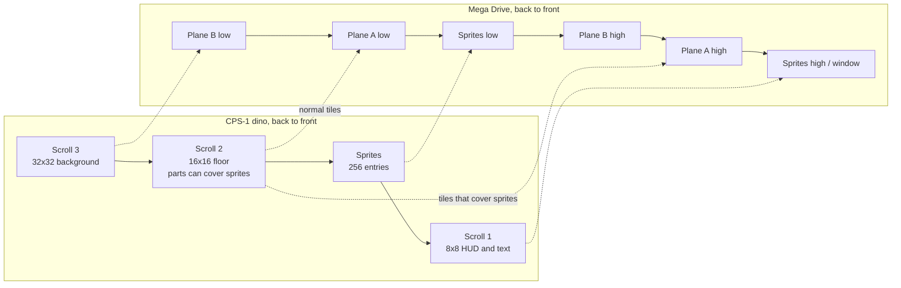

The colour reduction is the part with the most visible cost and the least mechanical solution. Arcade tiles are stored as 4-bit indexes into whichever palette the game assigns at run time, so the same tile can appear in different palettes. Converting to 4 shared palettes means deciding, per scene, which arcade palettes merge, and storing tile pixels already remapped.

## 6. Sound

| | CPS-1 (`dino`) | Mega Drive |
|---|---|---|
| Sound CPU | Z80 at 8 MHz, program Kabuki-encrypted (first 32 KB) | Z80 at 3.58 MHz, 8 KB RAM, program loaded by the 68000 |
| Tick | 250 Hz timer interrupt | One interrupt per frame; YM2612 timers |
| Synthesis | QSound DSP (DL-1425): 16 PCM voices + 3 ADPCM, 8-bit samples, 24.04 kHz stereo, positional panning, echo | YM2612: 6 four-operator FM channels, stereo panning; channel 6 can be an 8-bit DAC. PSG: 3 square + noise |
| Sample data | 2 MB ROM, full (**ROM**) | From cartridge ROM through the Z80's 32 KB bank window, mixed in software |
| 68000 → sound | Shared RAM at `0xF18000`; the VBlank handler copies queued commands in, with a ready flag at `0xF1801F` | Z80 RAM at `0xA00000` after a bus request |

Consequences:

- The soundtrack is sample-based and there is no FM version to copy. The known bootlegs replaced QSound with a single OKI sample chip, not with FM. Music has to be arranged for YM2612, starting from the QSound sequence data (VGMTrans has CPS sequence parsers that export MIDI).
- Sound effects and voices can stay as PCM at reduced rate through a Z80 PCM driver. Current drivers mix 2–4 channels at about 13–17 kHz (XGM2: 3 channels at 13.3 kHz; MDSDRV: 2 at 17.5 kHz or 3 at 13.3 kHz). One megabyte holds about 75–80 seconds at those rates.
- The command interface is narrow: the game queues sound command numbers and one routine in the VBlank handler delivers them. Replacing that routine is enough to redirect all sound.
- Z80 sample reads and 68000 DMA compete for the bus. A driver with DMA protection (XGM2, MDSDRV, Mega PCM 2) avoids crackle during heavy tile uploads.
- The decrypted Z80 program is obtainable (MAME carries the `dino` Kabuki keys), which gives the command list and sequence data, but the driver itself is useless on the Mega Drive.

## 7. Storage, input and saving

**ROM size.** Arcade content is 1.5 MB program + 4 MB graphics + 2 MB samples. The graphics are already 4 bpp, the same depth as the Mega Drive, so converted tiles are about the same size before compression. The total exceeds the 4 MB flat cartridge space. The Sega mapper (as in *Super Street Fighter II*) divides the 4 MB window into eight 512 KB regions; region 0 is fixed and regions 1–7 are switched by writing to `0xA130F3–0xA130FF`. Flash carts and BlastEm enable it from the header string `SEGA SSF`. A realistic ceiling for today's flash carts is 8–15 MB. For comparison, the Final Fight MD prototype in this folder is a flat 4 MB ROM (**ROM**), built as a rewrite with reduced assets.

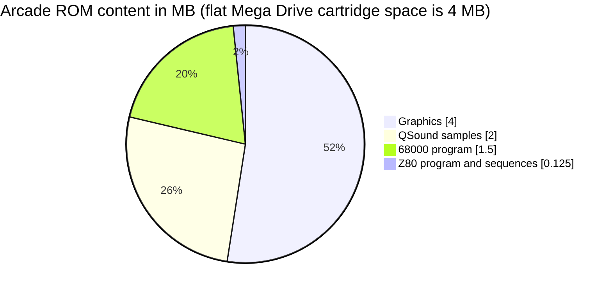

The 1.5 MB program needs to stay mapped at its original addresses in the fixed/low regions; graphics and samples go in switched banks.

**Input.** The arcade has three players with a stick and two buttons each, read active-low from `0x800000`, `0x800018` and `0xF1C000`. The Mega Drive pad protocol is different (TH line toggling, two reads per pad) but the game only reads inputs in one routine in the VBlank handler, which can build the same bytes from pads. A third player needs Team Player or EA 4-Way Play. Coin and service inputs need a mapping (for example Start as coin).

**Settings.** The arcade stores settings in a 93C46 serial EEPROM, bit-banged through `0xF1C006` (14 references in the program). Options are battery SRAM at `0x200001`, or a RAM-backed fake that loads defaults at boot.

## 8. What this means for the port

Two strategies exist; prior art has both.

**A. Rewrite.** New game written for the Mega Drive (typically C with SGDK), using the arcade only as reference. Final Fight MD and the 2022 Nemezes *Cadillacs and Dinosaurs Demake* are rewrites. Gameplay accuracy depends on how well behaviour is re-created; the demake dropped weapons and breakable objects.

**B. Keep the arcade 68000 code, replace the hardware.** The original program runs on the Mega Drive's 68000 with patches where it touches hardware, plus a new layer that turns the arcade's video tables into VDP work each frame. Precedents:

- *Shinobi* (System 16) and *Alien Syndrome* on Mega Drive: arcade code kept, hardware layer replaced, graphics pre-converted offline, Sega mapper, per-scene palette merging, FM music transcoded.
- JOTD's *Bad Dudes* for Amiga: original 68000 code with a generated patch list from a disassembly plus MAME traces.
- h0ffman's *Shinobi* and *Golden Axe* for Neo Geo: arcade ROM disassembled back to source.
- PC static recompilations of `dino` (2026) show the `dino` program runs correctly against a replaced hardware layer.

We found no CPS-1 game ported to the Mega Drive this way.

The shape of strategy B:

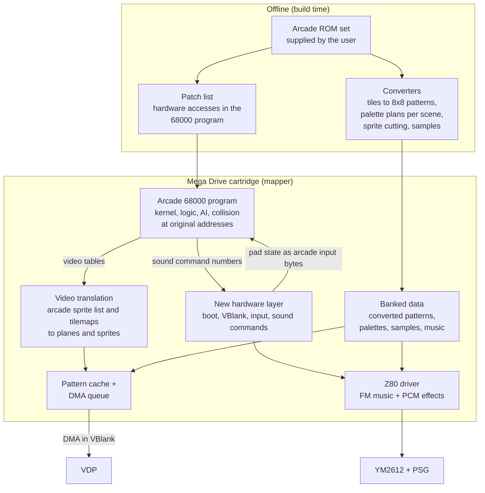

Why B looks feasible for `dino` specifically:

- Same CPU, same RAM address and size, program at address 0.
- The kernel, game logic, AI, collision and animation use no hardware.
- One interrupt; hardware registers are written almost only at reset and in the VBlank handler.
- Sound and input each pass through one routine.
- No protection on the 68000 side (no CPS-B ID check or multiply registers in MAME's `dino` configuration; program ROM unencrypted).

What makes it hard:

1. **Tile streaming.** Arcade code assumes any tile is free to show. The cache, upload scheduling and behaviour when the budget is exceeded decide how the port looks in motion.
2. **Colour.** 1,920 simultaneous colours into 61. Needs offline analysis of which palettes each scene uses (MAME traces) and a remapping pipeline.
3. **CPU time.** 55–64% of the arcade budget, minus the translation layer. Hot arcade routines that only build video tables may need to be replaced with versions that build Mega Drive tables directly.
4. **GFX RAM references.** About 2,100 direct ones. Options: give the game a shadow GFX RAM and translate it (costs RAM we may not have: the arcade tables in use total about 58 KB), or patch the writers to produce Mega Drive data. Work RAM usage has to be measured first.
5. **Screen width.** 64 px narrower, in a game laid out for 384.
6. **Sprite limits.** 80 sprites and 320 px per line in a three-player brawler.
7. **Music.** A full FM arrangement.

A phased plan built on strategy B, with A's techniques for assets, is the working assumption for the next document.

## 9. Next phase: three-way decompilation

The next step is to take apart three ROMs and compare them:

| ROM | Role |
|---|---|
| *Cadillacs and Dinosaurs* (World 930201), CPS-1 (`dino`) | The game to port |
| *Final Fight*, CPS-1 (`ffight`) | The arcade original of a game that has a well-regarded Mega Drive port |
| *Final Fight MD* (Mauro Xavier, fan port) | The reference for how a CPS-1 brawler is made to work on Mega Drive hardware |

What each comparison can teach:

- **`ffight` arcade vs `dino` arcade.** Both are Capcom CPS-1 brawlers a few years apart. Shared engine structure (task kernel, object structs, sprite and tilemap writers, sound command queue) tells us which findings about one carry over to the other.
- **`ffight` arcade vs Final Fight MD.** The same scenes on both machines show the concrete answers to the gaps in [section 5](#5-the-rendering-gap): how layers were mapped to planes, how palettes were merged per scene, how sprites were cut and budgeted, how the 384-wide layout was fitted to 320, how many patterns are uploaded per frame, and which sound driver and sample rates are used.
- **Apply to `dino`.** Use those answers as the starting configuration for the `dino` hardware layer and asset pipeline.

One caveat shapes how the second comparison is done. Final Fight MD's author states it was written from scratch without the original source, so its code will not correspond to the arcade's routine by routine. The comparison is therefore about data and behaviour (VRAM layout, palettes, sprite lists, DMA volume per frame, ROM layout), observed in an emulator's VDP debugger and in the disassembly of its engine, more than about matching functions. If its announced source release is available, that replaces most of the disassembly work for that ROM.

Ghidra is the default tool for all three (68000 support is built in; the two arcade programs need their ROM files byte-swapped and joined first, as done for the measurements in this document).

## Open questions

Hardware facts not settled by the sources we read:

- 68000 clock on a real `dino` board: 12 MHz in MAME, 10 MHz in some references.
- CPS-1 sprite capacity on real hardware (256 entries vs 256 tiles) and the exact moment the sprite list is latched.
- Mega Drive blanking transfer rate: 198, 204 or 205 bytes per line in H40 depending on source.
- VDP sprite table caching behaviour and sprite masking rules (recalled, not re-read).
- Team Player / 4-Way Play protocol details; flash cart size limits per model.
- Whether the Final Fight MD source has been published (announced for 2026); it would be the best reference for the tile and sprite budget problem.

Things to measure on `dino` itself:

- How much of the 64 KB work RAM the game uses.
- How many distinct tiles and palettes each stage shows per frame and per scene (from MAME traces).
- Peak sprite entries and sprite pixels per line during play.
- Whether stage tilemaps are compressed in ROM and how they are streamed into scroll RAM.
- How much frame time the arcade leaves idle at 12 MHz.
- Our reading of the TRAP services and the sound command handshake, checked in the MAME debugger.

## Sources

CPS-1

- MAME: [`cps1.cpp`](https://github.com/mamedev/mame/blob/master/src/mame/capcom/cps1.cpp), [`cps1_v.cpp`](https://github.com/mamedev/mame/blob/master/src/mame/capcom/cps1_v.cpp), [`cps1.h`](https://github.com/mamedev/mame/blob/master/src/mame/capcom/cps1.h), [`kabuki.cpp`](https://github.com/mamedev/mame/blob/master/src/mame/capcom/kabuki.cpp), [`qsound.cpp`](https://github.com/mamedev/mame/blob/master/src/devices/sound/qsound.cpp), [`qsoundhle.cpp`](https://github.com/mamedev/mame/blob/master/src/devices/sound/qsoundhle.cpp), [`cps1bl_pic.cpp`](https://github.com/mamedev/mame/blob/master/src/mame/capcom/cps1bl_pic.cpp)
- jotego jtcps1 notes: [OBJ](https://github.com/jotego/jtcps1/blob/master/doc/obj.md), [DMA](https://github.com/jotego/jtcps1/blob/master/doc/DMA.md)
- Fabien Sanglard: [CPS-1 graphics](https://fabiensanglard.net/cps1_gfx/index.html), [SF2 sound system](https://fabiensanglard.net/sf2_sound_system/), [ccps](https://fabiensanglard.net/ccps)
- Kabuki: [Arcade Hacker](https://arcadehacker.blogspot.com/2014/12/capcom-kabuki-cpu-part-2.html)
- QSound registers: [superctr's notes](https://gist.github.com/superctr/fa2491fcf48b070459db30814eb7330f)

`dino` reverse engineering

- [GameHackFan/dinore](https://github.com/GameHackFan/dinore) (RAM maps, patch sources), [cdree](https://github.com/GameHackFan/cdree)
- [zengfr/romhack `dino`](https://github.com/zengfr/romhack/tree/master/dino) and the [trace archive](https://github.com/zengfr/arcade_game_romhacking_sourcecode_top_secret_data/tree/master/dino)
- [VGMTrans](https://github.com/vgmtrans/vgmtrans) (CPS sequence parsers)
- [sf2platinum](https://sf2platinum.wordpress.com/) (CPS-1 game internals, SF2)

Mega Drive

- Charles MacDonald, [gen-hw.txt](https://gendev.spritesmind.net/mirrors/cmd/gen-hw.txt)
- [md.railgun.works VDP](https://md.railgun.works/index.php?title=VDP)
- plutiedev: [DMA](https://plutiedev.com/dma-transfer), [beyond 4 MB](https://plutiedev.com/beyond-4mb), [sprites](https://plutiedev.com/sprites), [controllers](https://plutiedev.com/controllers), [multitap](https://plutiedev.com/multitap), [SRAM](https://plutiedev.com/saving-sram), [ROM header](https://plutiedev.com/rom-header), [YM2612](https://plutiedev.com/ym2612-registers)
- Raster Scroll: [VDP overview](https://rasterscroll.com/mdgraphics/vdp-overview/), [inner workings](https://rasterscroll.com/mdgraphics/vdp-inner-workings/)
- SpritesMind: [video timings](https://gendev.spritesmind.net/forum/viewtopic.php?p=8077), [DMA rates](http://gendev.spritesmind.net/forum/viewtopic.php?t=851), [mid-line tricks](https://gendev.spritesmind.net/forum/viewtopic.php?p=28063)
- SGDK: [repository](https://github.com/Stephane-D/SGDK), [`dma.h`](https://raw.githubusercontent.com/Stephane-D/SGDK/master/inc/dma.h), [`mapper.h`](https://raw.githubusercontent.com/Stephane-D/SGDK/master/inc/mapper.h), [`xgm2.h`](https://raw.githubusercontent.com/Stephane-D/SGDK/master/inc/snd/xgm2.h)
- Sound drivers: [MDSDRV](https://github.com/superctr/MDSDRV), [Mega PCM](https://github.com/vladikcomper/MegaPCM)
- Krikzz [extended SSF mapper](https://raw.githubusercontent.com/krikzz/mega-ed-pub/master/extended-ssf.md); [BlastEm](https://www.retrodev.com/blastem/)

Prior art

- [Final Fight MD](https://mxretrodev.itch.io/final-fight-md)
- [Cadillacs and Dinosaurs Demake](https://warpzone.me/port-de-fa-de-cadillacs-and-dinosaurs-para-mega-drive-ja-esta-pronto-e-disponivel/) (Nemezes, 2022)
- [Shinobi Megadrive Beta](https://mr-xtodd.itch.io/shinobi-megadrive-beta), [Alien Syndrome MD](https://made-with-ai.itch.io/alien-syndrome-md), [Xain'd Sleena MD devlog](https://made-with-ai.itch.io/xaind-sleena-md/devlog/1786433/xaind-sleena-md-wip1-the-arcades-cpus-recompiled-widescreen-sound-on-the-z80)
- JOTD, [Bad Dudes for Amiga](https://github.com/jotd666/baddudes)
- h0ffman, [Shinobi for Neo Geo](https://h0ffman.itch.io/shinobi-neogeo)
- `dino` recompilations: [Cadillacs-and-Dinosaurs-Recomp](https://github.com/omegakatana92/Cadillacs-and-Dinosaurs-Recomp); CPS-2 conversion: [CPSConverter](https://github.com/Asure/CPSConverter)
