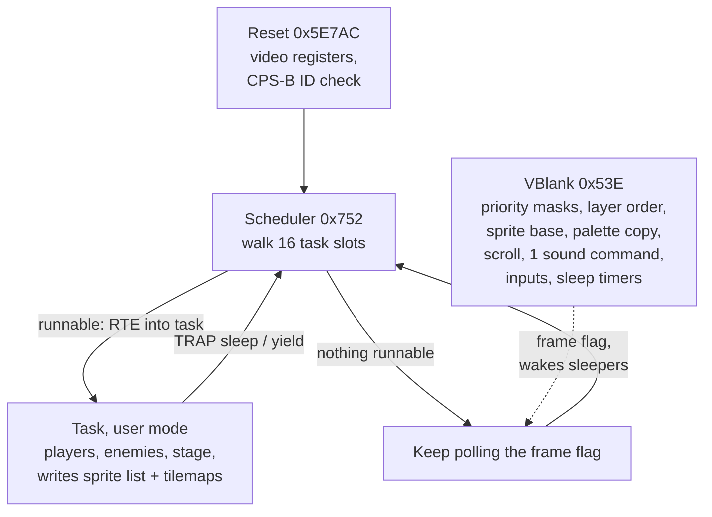
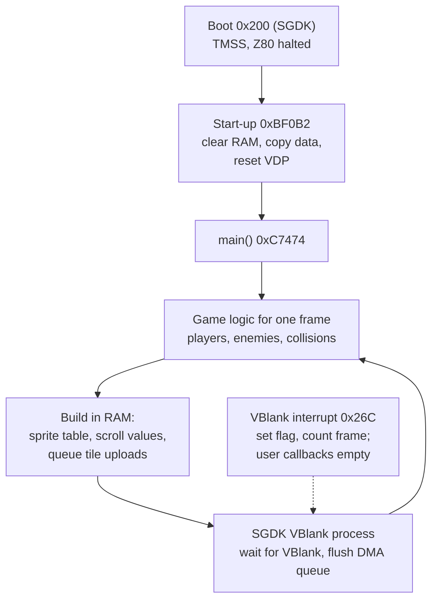
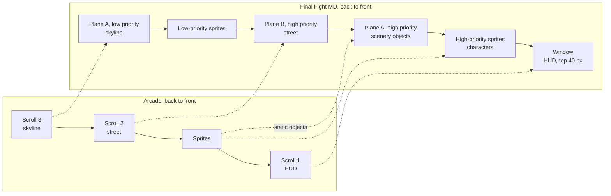
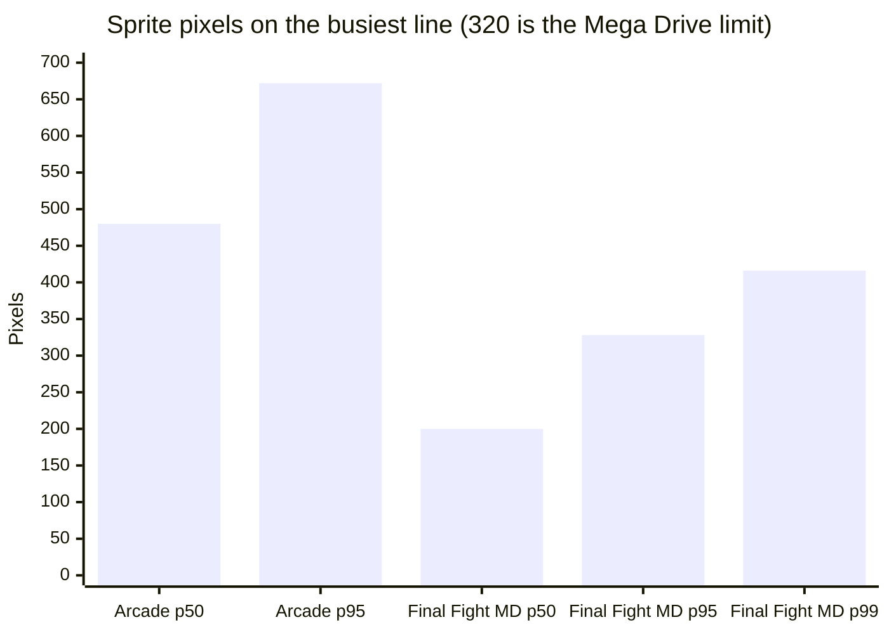
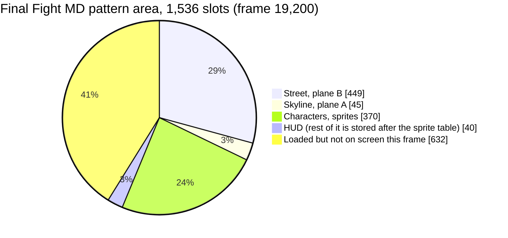

# Final Fight: arcade vs Final Fight MD

What the CPS-1 original does, what the fan-made Mega Drive port does instead, and what that teaches us for *Cadillacs and Dinosaurs*. Read [01-architecture-cps1-vs-mega-drive.md](01-architecture-cps1-vs-mega-drive.md) first for the hardware background.

## Sources and method

| | Arcade | Mega Drive |
|---|---|---|
| ROM | *Final Fight* (World), MAME set `ffight`, supplied by the user | *Final Fight MD* 0.92b, "Christmas 2025" build by CFX (Mauro Xavier), supplied by the user |
| Static analysis | Ghidra 12.1.3 headless (68000), plus our own disassembly scans | Same |
| Dynamic analysis | MAME 0.289 with a Lua trace script, 6 minutes (21,600 frames) | MAME 0.289 `genesis` with a Lua trace script, 6 minutes |

The traces record, for every frame:

- **Arcade:** the sprite list, the visible part of all three tilemaps, the palettes in use, the graphics on screen expressed in Mega Drive 8×8 patterns (only cells with visible pixels counted), and how often the scheduler polled for the next frame (a measure of CPU load).
- **Mega Drive:** every write to the VDP, decoded: DMA by size, target and source; palette changes; register writes during the visible picture; the sprite table after each frame. Full VRAM, CRAM and register dumps every 5 seconds (54 of them during gameplay).

Both games were driven by a script (insert coin, start, walk right in bursts, fight in bursts). Each run stayed in stage 1 (the slums) and included deaths, a game over and a restart.

Frames counted as gameplay:

- **Arcade: 15,170 frames** with sprites and both background layers on screen. This includes the attract-mode demo, which runs the same stage.
- **Mega Drive: 16,049 frames** after the script reached the game, with at least three sprites visible. Menus and the game-over screen are excluded.

**All numbers are for stage 1 under scripted play.** Later stages and real play may push the limits harder. Arcade counts cover the full 384-pixel-wide picture; a 320-pixel view would show about a sixth less of each layer.

Final Fight MD's author has said the source will be published on GitHub. It was not available when this was written, so everything about its internals comes from the ROM. Its title screen says "reprogrammed by CFX 2025" and its itch.io page says it was made without any of the original source code. A byte-level search agrees: the only sequences of 16 bytes or more shared with the arcade program are plain counting tables (644 bytes in all), none of them code.

Reproduction steps are in [`tools/README.md`](../tools/README.md).

## 1. Findings at a glance

| | Arcade (`ffight`) | Final Fight MD |
|---|---|---|
| Code | Hand-written 68000 assembly | C compiled by GCC, on SGDK |
| Program structure | 16-slot cooperative task kernel, game logic in tasks | One `main()` loop, SGDK library |
| Frame driver | VBlank interrupt does all hardware updates | Main loop flushes a DMA queue at VBlank; the interrupt only sets a flag |
| CPU | 68000 at 10 MHz; game work uses 56% of a frame on average | 68000 at 7.67 MHz |
| Resolution | 384×224 | 320×224 (H40) |
| Sprites on screen (mean / p95 / max) | 133 / 208 / 225 tiles of 16×16 | 23 / 36 / 46 hardware sprites (242 / 384 / 451 cells of 8×8) |
| Busiest sprite line (p95) | 42 tiles = 672 px | 328 px (the hardware limit is 320) |
| Lines over 320 sprite px per frame (mean) | 46 | 0.6 |
| Palettes in use | 25 of 192 (median), about 175 colours | 4 of 4, 46 colours |
| Palette changes during gameplay | sent every frame | 0.1% of frames: loaded per scene and left alone |
| Tile layers | 3 (scroll 1, 2, 3) | plane A, plane B, window |
| Graphics shown per frame | 1,675 patterns (median) | about 770 patterns (median of 54 dumps), 950 at most |
| New graphics per frame | 0 typical, 69 patterns p95 (cache model) | 1.1 KB DMA mean, 3.6 KB p95, 7.6 KB max |
| Raster effects | not measured | none: no HBlank interrupt, no line scroll, no mid-frame palette writes |
| Update rate | sprite list changes in 86% of frames | sprite table uploaded in 99.3% of frames (60 fps) |
| Sound | Z80 + YM2151 FM + OKI ADPCM | SGDK XGM2 driver, soundtrack re-arranged |
| ROM | 1 MB program + 2 MB graphics + sound | 4 MB flat, no mapper |

The lessons for Cadillacs and Dinosaurs are in [section 9](#9-lessons-for-cadillacs-and-dinosaurs).

## 2. How each program executes

### 2.1 Arcade: the same kernel design as Cadillacs and Dinosaurs

Final Fight (1989) runs on the same task kernel design we found in Cadillacs and Dinosaurs (1993): 16 task slots of 16 bytes, the same state codes, the same services on `TRAP #0`–`#7` (create, exit, kill, sleep, yield, suspend, resume, restart), the same `A5` global base and the same scheduler loop.

| | Final Fight | Cadillacs and Dinosaurs |
|---|---|---|
| CPU clock (MAME) | 10 MHz | 12 MHz |
| Reset | `0x5E7AC` | `0x41A` |
| VBlank (level 2) | `0x53E` | `0x542` |
| Scheduler loop | `0x752` | `0x83C` |
| Task slots | 16 × 16 bytes at `0xFF1000` | 16 × 16 bytes at `0xFF0052` |
| `TRAP #0` create task | `0x832` | `0x8DA` |
| Task stacks | fixed per slot | handed out from a pool of 16 |
| Extra kernel calls | `TRAP #8` restarts the game | `TRAP #12` sets the interrupt mask |
| Global base | `A5 = 0xFFFF8000` | `A5 = 0xFFFF8000` |
| Sound commands | ring buffer at `A5+0x184`, one per frame to the latch at `0x800180` | ring buffer, one per frame to QSound shared RAM at `0xF18000` |

**Copy protection.** At reset, Final Fight reads the CPS-B ID register (`0x800160`) and loops forever unless the value, masked with `0xFC3F`, is `0x0004`. MAME's configuration for Cadillacs and Dinosaurs lists no ID register and no multiply check; whether its program has any other check is still to be confirmed in its disassembly.

**Hardware references.** About 980 absolute references into GFX RAM in Final Fight, against about 2,100 in Cadillacs and Dinosaurs. The video registers are written almost only at reset and in VBlank, in both games.

### 2.2 How busy the arcade CPU is

When no task is runnable, the scheduler spins through the 16 slots, reading the frame flag once per slot (about 99 CPU cycles per read, from the instruction timings). Counting those reads per frame gives the time the CPU spent waiting; the rest is tasks, kernel calls and the VBlank handler.

| Final Fight arcade, per gameplay frame | mean | p50 | p95 | p99 | max |
|---|---|---|---|---|---|
| Share of the frame spent working | 56% | 57% | 64% | 67% | 76% |
| Cycles (of 167,700 at 10 MHz) | 94,000 | 96,000 | 107,000 | 112,000 | 127,000 |

Load rises with the number of sprites: 42% of the frame with fewer than 50 sprite tiles on screen, 60% with 150–200.

Against the Mega Drive's budget:

- A Mega Drive frame is 128,000 cycles. No measured frame of Final Fight needed more.
- With the CPU frozen for a full VBlank DMA, about 109,000 remain. 2.4% of frames needed more than that.

So Final Fight's original code would fit a Mega Drive frame almost always, but with little left over: the average frame leaves about 34,000 cycles for everything the arcade hardware did for free (translating sprite lists and tilemaps, managing VRAM). This is an estimate: the 99-cycle figure is computed, not measured, and a task that busy-waits would count as work.

### 2.3 Final Fight MD: SGDK and C

The boot code at `0x200` and the interrupt handlers are SGDK's (`sega.s`). The game itself is compiled C:

- Work RAM is addressed as `0xE0FF0000`, SGDK's linker alias for `0xFF0000`.
- The start-up routine at `0xBF0B2` clears RAM, copies initialised data from `0x3E8472` near the end of the ROM, resets the VDP, and calls `main()` at `0xC7474`.
- `main()` is 24 KB long and calls 126 other functions. The largest function in the ROM is 52 KB. Functions this size mean heavy inlining or very large `switch` statements: the code was written for C, not translated from the arcade.
- Ghidra found 380 functions covering about 830 KB; code sits in roughly the first 1 MB of the ROM and the rest is data.
- The splash screen says "Powered by SGDK / XGM2 sound driver". Error strings in the ROM ("not enough memory to reset VDP") are SGDK's.

Interrupts, read from the ROM and from RAM during gameplay:

- The VBlank handler sets a flag, increments a frame counter and calls two hooks held in RAM (`0xFF18DA`, `0xFF1B20`). Both pointed at an `RTS`. All per-frame video work happens in the main loop, not in the interrupt, and the music runs on the Z80 without help from this handler.
- The HBlank vector jumps through a RAM stub to another `RTS`, and the HBlank interrupt is never enabled.
- The VBlank handler supports SGDK's preemptible user task. The CPU was in supervisor mode at every frame end we sampled, so that feature appears unused.

**The contrast:** the arcade program is many small tasks woken by an interrupt that also drives the hardware. Final Fight MD is one loop where the hardware is touched only through SGDK's queue at VBlank.

## 3. Screen and layers

### 3.1 Layer mapping

Rendering Final Fight MD's VRAM during stage 1 shows where the picture comes from. The arcade column is our reading of the arcade's layer order (scroll 3 at the back, scroll 1 in front) and tile counts; we did not render the arcade layers separately.

| Arcade layer | Content | Final Fight MD | Priority bit |
|---|---|---|---|
| Scroll 2 (16×16 tiles) | Street, buildings, doors, bins | **Plane B**, 64×32 cells | high |
| Scroll 3 (32×32 tiles) | Distant skyline | **Plane A**, 64×32 cells | low |
| Scroll 1 (8×8 tiles) | HUD: names, health, score, time | **Window**, top 5 rows (40 px) | high |
| Sprites | Characters, items, effects | **Sprites**, plus some scenery on plane A | high (most) |

- **Inverted plane order.** The hardware's default order puts plane A in front of plane B. Final Fight MD puts the street on plane B with every cell high priority (49 of 54 gameplay dumps) and the skyline on plane A with low priority, so the street draws over the skyline. The window replaces plane A wherever it is shown, so the layer that shares a plane with the HUD has to be the one that can lose its top 40 pixels.
- **Scenery objects as tiles.** In the opening area a stack of oil drums is drawn on plane A with the priority bit set, in front of the street, while another stack on the same screen is made of sprites. Objects that stand still can live on a plane and cost no sprites. 25 of the 54 dumps have high-priority cells on plane A.
- **Skyline pieces as sprites.** In the HUD band plane A is replaced by the window, so skyline that should show there would be missing. Every gameplay dump has 3 to 5 sprites in that band; in the frames we rendered they are building tops.

### 3.2 Width

The arcade picture is 384 pixels wide and the Mega Drive's is 320. Final Fight MD shows a 320-pixel view of the stage with the HUD re-laid-out to fit. We did not measure how its scroll limits or enemy spawn points differ from the arcade's.

### 3.3 Scrolling and raster effects

- Both planes use whole-plane scrolling (horizontal mode 0, vertical mode 0) in every gameplay frame.
- No HBlank interrupt, no per-line scroll, no mid-frame palette writes, and about 0.4 register writes per frame during the visible picture.

Final Fight MD needs no raster tricks for stage 1, which keeps CPU time free. (The arcade program turns row scroll off at reset; we did not log whether it turns it on later.)

## 4. Sprites

### 4.1 Arcade

Final Fight builds its sprites almost entirely from **single 16×16 tiles**: the trace found 132.5 sprite list entries for 133.1 tiles per frame on average, and entries equalled tiles in 89% of frames. A character is many independent entries. The CPS-1 can also draw a block of up to 16×16 tiles from one entry; Final Fight rarely does.

| Arcade, per gameplay frame | mean | p50 | p95 | max |
|---|---|---|---|---|
| Visible sprite tiles | 133 | 135 | 208 | 225 |
| Distinct tiles | 84 | 85 | 122 | 151 |
| Tiles on the busiest line | 29 | 30 | 42 | 68 |
| Lines over 320 sprite pixels | 46 | 54 | 80 | 91 |

On a typical frame about a quarter of the picture's lines carry more sprite pixels than the Mega Drive can display at all.

### 4.2 Final Fight MD

| Final Fight MD, per gameplay frame | mean | p50 | p95 | p99 | max |
|---|---|---|---|---|---|
| Visible hardware sprites | 23 | 23 | 36 | 43 | 46 |
| 8×8 cells in them | 242 | 250 | 384 | 435 | 451 |
| Sprites on the busiest line | 8 | 8 | 12 | 15 | 25 |
| Sprite pixels on the busiest line | 200 | 200 | 328 | 416 | 600 |
| Lines over a hardware limit | 0.6 | 0 | 1 | 16 | 37 |

- About 10.7 cells per hardware sprite on average: characters are built from few, large pieces (up to 32×32), not from 16×16 tiles. With at most 80 sprites, large pieces are the only way to fit a crowd.
- 5.1% of gameplay frames have at least one line over the 320-pixel limit, which means dropped sprite pieces on those lines. The 20-sprites-per-line limit is hit in only 0.2% of frames. Final Fight MD is designed right up to the pixel limit and accepts brief overflow in the busiest moments.
- It never comes near the 80-sprite total (maximum 46).

Our data cannot tell how the reduction was achieved: fewer enemies at once, tighter cut-outs, or different spacing. The two runs are also not the same play-through, so this is a comparison of typical load, not of identical scenes. Counting enemies in work RAM on both sides is a follow-up item.

## 5. Colour

### 5.1 Arcade

- 25 palettes in use per gameplay frame at the median (mean 22.5): most often 13 for the street layer, 6 for the HUD, 1 for the skyline, and about 5 for sprites (up to 9).
- About 175 distinct colours across those palettes. This counts every entry of each palette in use, not every pixel drawn, and compares the 12-bit RGB value without the brightness nibble.
- The palette is re-sent to the hardware every frame by the VBlank handler.

### 5.2 Final Fight MD

- 46 distinct colours in CRAM in 99.8% of gameplay frames. Each of the four palette lines holds 15 distinct colours; some colours repeat across lines.
- CRAM changed in 0.1% of gameplay frames: one palette set per scene, loaded at the scene change and left alone.
- Allocation in one gameplay dump (frame 19,200):

| Palette line | Used by |
|---|---|
| 3 | Almost all of the street plane B (1,560 of 1,575 cells) and the skyline plane A (724 of 998); 5 of 35 sprites |
| 0 | Most of the HUD, the rest of the skyline, a few street cells; 8 sprites |
| 1 | 12 sprites |
| 2 | Part of the HUD; 10 sprites |

So one line (15 colours) carries nearly the whole background of the scene, and the characters and HUD share the other three. Every enemy type in a scene has to be drawn with the shared colours, which is how about 25 arcade palettes fold into 4.

This is the trick with the largest visual impact. Our inference is that it required recolouring the arcade art per scene by hand or with offline tools: nothing in the trace converts colours at run time, and the project's credits list "color management" as a separate job.

## 6. Graphics streaming

### 6.1 How much the arcade shows at once

The arcade trace counted, for every frame, the non-blank 8×8 pieces of every visible tile: the patterns a Mega Drive would need in VRAM to show that exact 384-pixel-wide frame.

| Arcade, per gameplay frame | mean | p50 | p95 | max |
|---|---|---|---|---|
| Patterns on screen | 1,658 | 1,675 | 1,823 | 1,905 |
| New since the previous frame | 18 | 0 | 69 | 1,014 |

Roughly where they come from, at the median: 178 street tiles (up to 712 patterns), 42 skyline tiles of 32×32 (up to 672), 85 sprite tiles (up to 340) and 66 HUD tiles.

- 87% of arcade frames show more than 1,536 patterns, the size of Final Fight MD's pattern area, before any animation frames are held in reserve.
- The rate of change is low. With a 1,400-pattern cache, a typical frame needs no new patterns, and only 5 frames in the whole run needed more than the roughly 230 patterns one VBlank can transfer.

The problem is capacity, not bandwidth: a frame of arcade Final Fight is too big for VRAM, but frames change slowly.

### 6.2 What Final Fight MD keeps in VRAM

The layout was the same in all 54 gameplay dumps:

| VRAM | Use |
|---|---|
| `0x0000`–`0xBFFF` | Pattern area, 1,536 slots: background from slot `0x015`, skyline from `0x25E`, sprites from `0x2BC` |
| `0xC000` | Plane B name table |
| `0xD000` | Window name table; only 5 rows are shown, and the unused rows hold extra patterns |
| `0xE000` | Plane A name table |
| `0xF000` | Horizontal scroll table |
| `0xF400` | Sprite table |
| `0xFC80`–`0xFFFF` | HUD patterns, in the free space after the sprite table |

Patterns on screen, by user:

| | min | median | max | Arcade equivalent (median) |
|---|---|---|---|---|
| Street, plane B | 312 | 449 | 460 | up to 712 |
| Skyline and scenery, plane A | 45 | 45 | 108 | up to 672 |
| Sprites | 83 | 247 | 402 | up to 340 |
| HUD, window | 29 | 58 | 69 | 66 |
| **Total** | **500** | **768** | **950** | **1,675** |

- **The backgrounds were reduced, the characters were not.** The skyline went from about 42 large tiles to 45 patterns, and the street from about 700 patterns to about 450. Sprites use a similar number of patterns to the arcade's.
- **Spare table space holds patterns.** The window shows only 5 of its 32 rows, and the sprite table ends well before the end of VRAM. Final Fight MD stores patterns in both gaps: up to 127 on-screen patterns came from them in one dump.
- **Headroom is kept.** In the dump above, 632 pattern slots hold graphics that are not on screen in that frame (other animation frames, parts of the plane outside the view).

### 6.3 Transfer per frame

| Final Fight MD, per gameplay frame | mean | p50 | p95 | p99 | max |
|---|---|---|---|---|---|
| DMA to VRAM, bytes | 1,067 | 280 | 3,560 | 5,160 | 7,552 |
| DMA started during the visible picture, bytes | 5 | 0 | 0 | 128 | 832 |
| DMA operations | 1.7 | 1 | 4 | 6 | 25 |
| CPU writes to VRAM, bytes | 3 | 0 | 8 | 68 | 684 |

- A typical frame moves 280 bytes, which matches a sprite-table upload on its own. The 95th percentile is 3.6 KB, about half of the roughly 7.3 KB a VBlank allows. The maximum, 7.6 KB, is at the budget.
- 99.6% of DMA bytes are sent during VBlank.
- 66% of DMA bytes come straight from ROM and 34% from work RAM. Graphics sent from ROM must already be stored uncompressed in the Mega Drive's tile format. The RAM share includes the sprite table.
- Scene changes clear VRAM with DMA fill (up to 64 KB) outside gameplay.

Final Fight MD stays far below its bandwidth budget in normal play. Its limiting resource is VRAM capacity, the same thing the arcade measurement predicts.

## 7. Sound

| | Arcade | Final Fight MD |
|---|---|---|
| Hardware | Z80 at 3.58 MHz, YM2151 (8 FM channels), OKI MSM6295 (4 ADPCM channels) | Z80, YM2612 (6 FM), PSG |
| Driver | Capcom's Z80 driver | SGDK XGM2 (named on the splash screen) |
| 68000 → sound | ring buffer of command numbers, one per frame to the latch at `0x800180` (`0x800188` for fades) | calls into the XGM2 library; not traced |
| Music | original | re-arranged for YM2612: the jukebox lists the original composers and "recreated by Edmo Caldas" |

The arcade's sound interface is a narrow queue of command numbers, the same design as Cadillacs and Dinosaurs' QSound queue. Final Fight MD replaced the whole sound system rather than translating the arcade's YM2151 data. We did not analyse the sound side further (channel use, sample rates, ROM space).

## 8. Everything else

- **ROM.** 4 MB flat, no Sega mapper (no `SEGA SSF` header). Code fills about the first 1 MB (the header's ROM-end field says `0x0FFFFF`), graphics and sound the rest.
- **Saving.** Battery SRAM declared at `0x200001`–`0x20FFFF`, odd bytes (32 KB). The SRAM control register was written 332 times in the run, all outside gameplay.
- **Input.** Multitap support (checked at boot), three players, pad configuration (attack, jump, special, turbo).
- **Options beyond the arcade.** Arcade mode and a "Mega mode" (juggling, extra moves, extra bosses), boss rush, time attack, survivor, achievements, a jukebox.
- **Frame rate option.** "EX performance: on (auto FPS) / off (60 fps fixed)". At the default setting the sprite table was uploaded in 99.3% of gameplay frames, so stage 1 ran at a steady 60 fps.
- **Boot self-test.** VDP sprites, main RAM, video RAM, multitap, compatibility, SRAM and ROM checks.

## 9. Lessons for Cadillacs and Dinosaurs

What Final Fight MD shows works, and how it applies to the port described in [doc 01](01-architecture-cps1-vs-mega-drive.md):

1. **Fixed palettes per scene, planned offline.** One 15-colour line for the background, three shared by characters and HUD, no run-time palette traffic. Cadillacs and Dinosaurs uses fewer palettes per frame than Final Fight (16 against 25, see [doc 03](03-cadillacs-and-dinosaurs-measured.md)).
2. **Map the layers the same way.** Street layer to plane B with high priority, far layer to plane A with low priority, HUD to the window, sprite patches where the far layer must show inside the HUD band.
3. **Put static objects on a plane.** Scenery that does not move can be drawn as high-priority tiles and cost no sprites.
4. **Use every byte of VRAM.** Fixed pattern regions per scene, with extra patterns in the unused window rows and after the sprite table. Graphics uncompressed in Mega Drive format, sent by DMA straight from ROM.
5. **Large sprite pieces.** Cut characters into pieces of up to 32×32 offline, about 10 cells per hardware sprite, and design for 320 pixels per line with brief overflow tolerated.
6. **Bandwidth is not the bottleneck; VRAM size is.** Final Fight MD shows less than half the patterns of an arcade frame, and the cut came from the backgrounds, not the characters.
7. **No raster effects needed** for the basic picture, which leaves CPU time for the game.
8. **Sound: replace, don't translate.** Both games queue command numbers; the port can keep that queue and feed an XGM2-class driver with re-arranged music and PCM effects.

Where we differ from Final Fight MD by design: it is a C rewrite, and we plan to keep Capcom's 68000 code. The shared kernel design and the narrow hardware interface support that plan. On CPU time, Final Fight's own code would fit a Mega Drive frame but with only about a quarter of the frame to spare on average ([section 2.2](#22-how-busy-the-arcade-cpu-is)). Cadillacs and Dinosaurs runs on a faster 12 MHz CPU and does use more: its measurements are in [doc 03](03-cadillacs-and-dinosaurs-measured.md).

## 10. Open items

- **Cadillacs and Dinosaurs traces.** Done for stage 1: see [doc 03](03-cadillacs-and-dinosaurs-measured.md).
- **Later stages.** All numbers are stage 1. Stages with more enemies or effects need their own traces (a save state or a stage-select input script).
- **Same-scene comparison.** Drive both versions to the same moments to compare enemy counts, spawn positions and scroll limits directly.
- **Arcade layer renders.** Render scroll 1, 2 and 3 separately to confirm which arcade layer carries what.
- **Sound.** Channel use and sample rates in Final Fight MD's XGM2 data, and the ROM space music and effects take.
- **Final Fight MD source.** When published, check the sprite engine, VRAM allocator and palette tools against these measurements.
