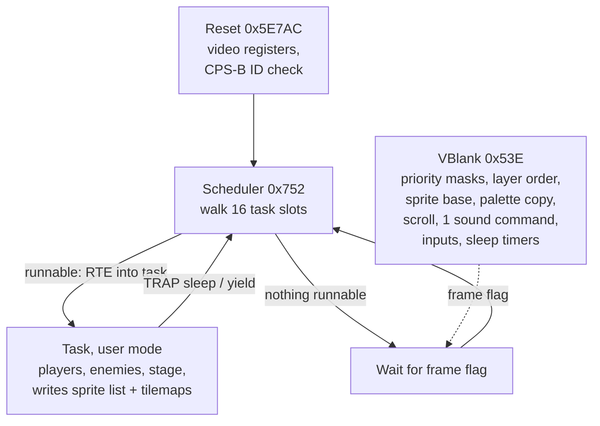
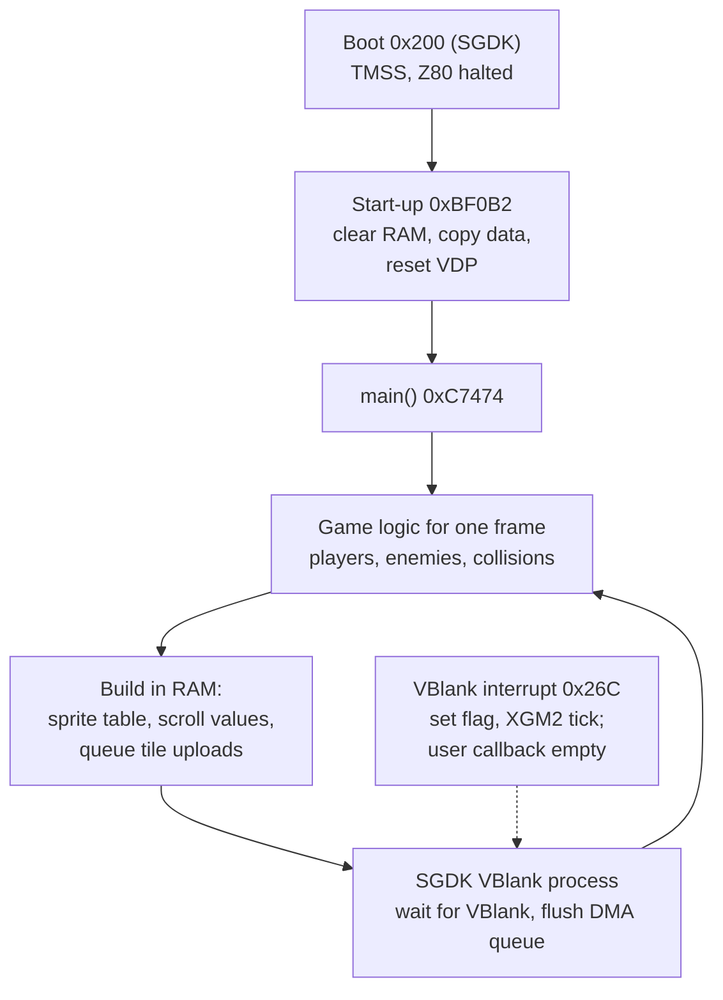
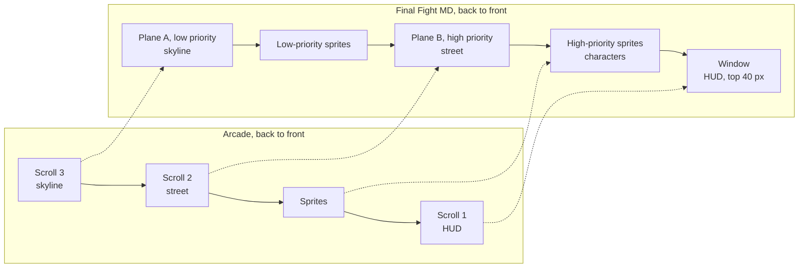
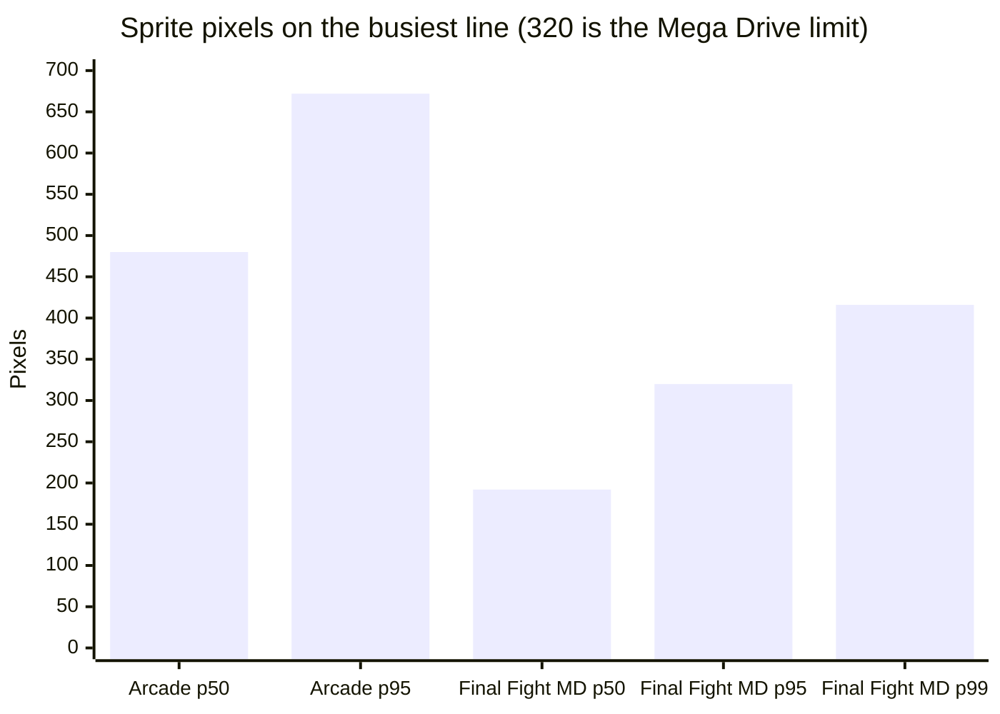
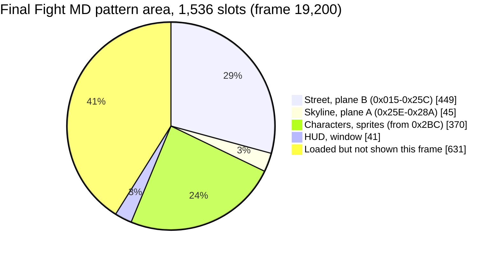

# Final Fight: arcade vs Final Fight MD

What the CPS-1 original does, what the fan-made Mega Drive port does instead, and what that teaches us for *Cadillacs and Dinosaurs*. Read [01-architecture-cps1-vs-mega-drive.md](01-architecture-cps1-vs-mega-drive.md) first for the hardware background.

## Sources and method

| | Arcade | Mega Drive |
|---|---|---|
| ROM | *Final Fight* (World), MAME set `ffight`, supplied by the user | *Final Fight MD* 0.92b, "Christmas 2025" build by CFX (Mauro Xavier), supplied by the user |
| Static analysis | Ghidra 12.1.3 headless (68000), plus our own disassembly scans | Same |
| Dynamic analysis | MAME 0.289 with a Lua trace script, 6 minutes (21,600 frames) | MAME 0.289 `genesis` with a Lua trace script, 6 minutes |

The traces record, for every frame:

- **Arcade:** the sprite list, the visible part of all three tilemaps, the palettes in use, and the graphics working set expressed in Mega Drive 8×8 patterns (only cells with visible pixels counted).
- **Mega Drive:** every write to the VDP, decoded: DMA by size, target and source; palette changes; register writes during the visible picture; the sprite table after each frame. Full VRAM, CRAM and register dumps every 5 seconds.

Both games were driven by a script (insert coin, start, walk right in bursts, fight in bursts). Each run covered stage 1 (the slums), including deaths, a game over and a restart. Gameplay frames: 15,170 arcade, 16,650 Mega Drive. **All numbers below are for stage 1 under scripted play.** Later stages and real play may push the limits harder.

Final Fight MD's author has said the source will be published on GitHub. It was not available when this was written, so everything about its internals comes from the ROM. Its title screen says "reprogrammed by CFX 2025" and its itch.io page says it was made without any of the original source code; the code we found agrees (see [section 2](#2-how-each-program-executes)).

Reproduction steps are in [`tools/README.md`](../tools/README.md).

## 1. Findings at a glance

| | Arcade (`ffight`) | Final Fight MD |
|---|---|---|
| Code | Hand-written 68000 assembly | C compiled by GCC, on SGDK |
| Program structure | 16-slot cooperative task kernel, game logic in tasks | One `main()` loop, SGDK library |
| Frame driver | VBlank interrupt does all hardware updates | Main loop asks SGDK to flush a DMA queue in VBlank; the interrupt only ticks the sound driver |
| Resolution | 384×224 | 320×224 (H40) |
| Sprites on screen (mean / p95 / max) | 133 / 208 / 225 single 16×16 tiles | 22 / 36 / 46 hardware sprites (233 / 383 / 451 cells of 8×8) |
| Busiest sprite line (p95) | 42 tiles = 672 px | 320 px (exactly the hardware limit) |
| Lines over 320 sprite px per frame (mean) | 46 | 0.5 |
| Palettes in use (mean) | 25 of 192, about 175 colours | 4 of 4, 46 colours |
| Palette changes during gameplay | — | none: CRAM is loaded per scene and left alone |
| Tile layers | 3 (scroll 1, 2, 3) | plane A, plane B, window |
| Graphics shown per frame | 1,675 patterns (p50) | about 930 patterns, in a 1,536-slot pattern area |
| New graphics per frame | 0 typical, 69 patterns p95 (cache model) | 1.0 KB DMA mean, 3.5 KB p95, 7.5 KB max |
| Raster effects | none needed | none used: no HBlank interrupt, no line scroll, no mid-frame palette writes |
| Update rate | sprite list changes in 86% of frames | sprite table updated in 96% of frames (about 57–58 per second) |
| Sound | Z80 + YM2151 FM + OKI ADPCM | SGDK XGM2 driver, soundtrack re-arranged |
| ROM | 1 MB program + 2 MB graphics + sound | 4 MB flat, no mapper |

The lessons for Cadillacs and Dinosaurs are in [section 9](#9-lessons-for-cadillacs-and-dinosaurs).

## 2. How each program executes

### 2.1 Arcade: the same kernel as Cadillacs and Dinosaurs

Final Fight (1989) runs on the same task kernel we found in Cadillacs and Dinosaurs (1993). The slot layout, state codes and TRAP numbers are identical; only the addresses moved.

| | Final Fight | Cadillacs and Dinosaurs |
|---|---|---|
| Reset | `0x5E7AC` | `0x41A` |
| VBlank (level 2) | `0x53E` | `0x542` |
| Scheduler loop | `0x752` | `0x83C` |
| Task slots | 16 × 16 bytes at `0xFF1000` | 16 × 16 bytes at `0xFF0052` |
| `TRAP #0` create task | `0x832` | `0x8DA` |
| Global base | `A5 = 0xFFFF8000` | `A5 = 0xFFFF8000` |
| Sound commands | ring buffer at `A5+0x184`, one per frame to the latch at `0x800180` | ring buffer, one per frame to QSound shared RAM at `0xF18000` |

Two details worth noting:

- **Copy protection.** At reset, Final Fight reads the CPS-B ID register (`0x800160`) and loops forever unless it reads `0x0004`. Cadillacs and Dinosaurs has no such check (its CPS-B-21 configuration has no ID register), which matters for keeping its code: one less patch.
- **CPU slack.** In 69% of gameplay frames the arcade program had already returned to the idle scheduler loop when VBlank arrived (sampled from the program counter at the end of each frame). In the other 31% it was still working. At 12 MHz Final Fight is not idle most of the time, so its code would not simply fit in a 7.67 MHz Mega Drive without optimisation.

**Hardware references.** About 980 absolute references into GFX RAM in Final Fight, against about 2,100 in Cadillacs and Dinosaurs. The video registers are written almost only at reset and in VBlank, in both games.

### 2.2 Final Fight MD: SGDK and C

The boot code at `0x200` and the interrupt handlers are SGDK's (`sega.s`). The game itself is compiled C:

- Work RAM is addressed as `0xE0FF0000`, SGDK's linker alias for `0xFF0000`.
- The start-up routine at `0xBF0B2` clears RAM, copies initialised data from the end of the ROM (`0x3E8472`), resets the VDP, and calls `main()` at `0xC7474`.
- `main()` is 24 KB long and calls 126 other functions. The largest function in the ROM is 52 KB. Functions this size mean heavy inlining or very large `switch` statements: the code was written for C, not translated from the arcade.
- About 830 KB of the 4 MB ROM is code, Ghidra finding 380 functions; the rest is data.
- The splash screen says "Powered by SGDK / XGM2 sound driver". Error strings in the ROM ("not enough memory to reset VDP") are SGDK's.

Interrupts, read from RAM during gameplay:

- The VBlank user callback (`0xFF1B20`) and the second hook (`0xFF18DA`) both point at an `RTS`. All per-frame video work happens in the main loop, not in the interrupt.
- The HBlank vector jumps through a RAM stub to another `RTS`, and the HBlank interrupt is never enabled.
- The VBlank handler supports SGDK's preemptible user task, but the CPU never ran in user mode during the trace, so that feature is unused.

**The contrast:** the arcade program is many small tasks woken by an interrupt that also drives the hardware. Final Fight MD is one loop where the hardware is touched only through SGDK's queue at VBlank.

## 3. Screen and layers

### 3.1 Layer mapping

Rendering Final Fight MD's VRAM during stage 1 shows where each arcade layer went:

| Arcade layer | Content | Final Fight MD | Priority bit |
|---|---|---|---|
| Scroll 2 (16×16 tiles) | Street, buildings, doors, bins | **Plane B**, 64×32 cells, refilled column by column while scrolling | high |
| Scroll 3 (32×32 tiles) | Distant skyline | **Plane A**, 64×32 cells | low |
| Scroll 1 (8×8 tiles) | HUD: names, health, score, time | **Window**, top 5 rows (40 px) | high |
| Sprites | Characters, items, effects | **Sprites** | high (most) |

The hardware's default order puts plane A in front of plane B. Final Fight MD inverts it with priority bits: every cell of the street plane (B) is high priority and every cell of the skyline plane (A) is low, so the street draws over the skyline. The reason is the window. The window replaces plane A wherever it is shown, so the HUD has to take plane A's place, and the far layer is the one that can afford to lose its top 40 pixels.

**The skyline-under-HUD trick.** Where the skyline would show through in the HUD band, plane A is replaced by the window, so those pixels would be missing. Final Fight MD redraws the few skyline pieces that poke into that band as sprites. Three small building-top sprites sit there in our dump.

### 3.2 Width

The arcade picture is 384 pixels wide and the Mega Drive's is 320. Final Fight MD shows a 320-pixel window onto the same stage layout: the HUD is re-laid-out to fit, and the stage scrolls a little earlier.

### 3.3 Scrolling and raster effects

- Both planes use whole-plane scrolling (horizontal mode 0, vertical mode 0) in every gameplay frame.
- No HBlank interrupt, no per-line scroll, no mid-frame palette writes, and about 0.4 register writes per frame during the visible picture.

The arcade's stage 1 doesn't use line scroll either, so nothing is lost. The conclusion is that Final Fight MD needs no raster tricks at all, which keeps CPU time free.

## 4. Sprites

### 4.1 Arcade

Final Fight builds every sprite from **single 16×16 tiles**: each of the 256 sprite list entries is one tile (in our trace, entries = tiles in every frame). A character is a cloud of 10–30 independent tiles. Cadillacs and Dinosaurs, four years later, uses the CPS-1's multi-tile blocks instead, so its lists are shorter.

| Arcade, per gameplay frame | mean | p50 | p95 | max |
|---|---|---|---|---|
| Visible sprite tiles | 133 | 135 | 208 | 225 |
| Distinct tiles | 84 | 85 | 122 | 151 |
| Tiles on the busiest line | 29 | 30 | 42 | 68 |
| Lines over 320 sprite pixels | 46 | 54 | 80 | 91 |

On a typical frame about a quarter of the picture has more sprite pixels per line than the Mega Drive can display at all.

### 4.2 Final Fight MD

| Final Fight MD, per gameplay frame | mean | p50 | p95 | p99 | max |
|---|---|---|---|---|---|
| Visible hardware sprites | 22 | 23 | 36 | 43 | 46 |
| 8×8 cells in them | 233 | 245 | 383 | 435 | 451 |
| Sprites on the busiest line | 7 | 7 | 12 | 15 | 25 |
| Sprite pixels on the busiest line | 193 | 192 | 320 | 416 | 600 |
| Lines over a hardware limit | 0.5 | 0 | 0 | 16 | 37 |

About 10.6 cells per hardware sprite on average: characters are built from few, large pieces (up to 32×32), not from 16×16 tiles. With at most 80 sprites, large pieces are the only way to fit a crowd.

The busiest line reaches exactly 320 pixels at the 95th percentile and exceeds it in about 1% of frames, which means dropped sprite pieces on those lines. Final Fight MD is designed right up to the limit and accepts brief overflow in the busiest moments.

Our data cannot tell how this was achieved: fewer enemies at once, smaller cut-outs, or tighter spacing. Counting enemies in work RAM on both sides is a follow-up item.

## 5. Colour

### 5.1 Arcade

- 25 palettes in use per gameplay frame (mean): about 13 for the street layer, 6 for the HUD, 1 for the skyline, and about 5 for sprites (up to 9).
- About 175 distinct colours across those palettes (an upper bound: it counts every entry of a palette in use, not every pixel).
- Palettes are re-sent every frame.

### 5.2 Final Fight MD

- 46 distinct colours in CRAM during every gameplay frame; each of the four lines holds 15 distinct colours.
- CRAM did not change in 99% of gameplay frames: one palette set per scene, loaded at the scene change and left alone. No fades by palette rewriting appeared in stage 1.
- Allocation seen in VRAM:

| Palette line | Used by (frame 19,200) |
|---|---|
| 3 | Almost all of the street plane B (1,560 of 1,575 cells) and the skyline plane A (724 of 998); 5 of 35 sprites |
| 0 | Most of the HUD, the rest of the skyline, a few street cells; 8 sprites |
| 1 | 12 sprites |
| 2 | Part of the HUD; 10 sprites |

So one line (15 colours) carries the whole background of a scene, and the characters and HUD share the other three. Every enemy type in a scene has to be drawn with the shared colours, which is how the 25 arcade palettes fold into 4.

This is the trick with the largest visual impact. It required redrawing or recolouring the arcade art per scene (the in-game credits name a separate person for "colour management"), not converting it automatically at run time.

## 6. Graphics streaming

### 6.1 How much the arcade shows at once

The arcade trace counted, for every frame, the non-blank 8×8 pieces of every visible tile: the patterns a Mega Drive would need in VRAM to show that exact frame.

| Arcade, per gameplay frame | mean | p50 | p95 | max |
|---|---|---|---|---|
| Patterns visible (working set) | 1,658 | 1,675 | 1,823 | 1,905 |
| New since the previous frame | 18 | 0 | 69 | 1,014 |
| Uploads needed with a 1,400-pattern cache | 18 | 0 | 69 | 1,014 |

- 93% of arcade frames show more distinct graphics than a Mega Drive VRAM can hold, before counting the sprite and scroll tables.
- On the other hand, the rate of change is low. With a cache the size of VRAM, a typical frame needs no new patterns and only 5 frames in 6 minutes needed more than the roughly 230 patterns one VBlank can transfer.

The problem is capacity, not bandwidth: a frame of arcade Final Fight is too big for VRAM, but frames change slowly.

### 6.2 What Final Fight MD keeps in VRAM

VRAM layout in gameplay: name tables from `0xC000` (plane B `0xC000`, window `0xD000`, plane A `0xE000`, horizontal scroll `0xF000`, sprite table `0xF400`), which leaves slots `0x000`–`0x5FF` (1,536 patterns) for graphics. A gameplay dump at frame 19,200:

- Pattern slots split into fixed regions: background from `0x015`, skyline from `0x25E`, sprites from `0x2BC`. The background region is filled per scene; the sprite region is reloaded as animation frames change.
- The street plane uses 396–449 distinct patterns, against about 700 that the arcade's street layer shows per frame. The background was reduced for the port, not copied tile for tile.
- About 930 patterns are on screen in this frame; 631 more slots hold graphics not shown in this frame (other animation frames, the rest of the plane). 1,745 of the 2,048 32-byte VRAM slots hold data, tables included. VRAM is nearly full.

### 6.3 Transfer per frame

| Final Fight MD, per gameplay frame | mean | p50 | p95 | p99 | max |
|---|---|---|---|---|---|
| DMA to VRAM, bytes | 1,030 | 264 | 3,544 | 5,128 | 7,552 |
| DMA during the visible picture, bytes | 5 | 0 | 0 | 128 | 3,072 |
| DMA operations | 1.7 | 1 | 3 | 6 | 25 |
| CPU writes to VRAM, bytes | 3 | 0 | 8 | 68 | 1,088 |

- A typical frame moves 264 bytes (the sprite table and scroll); the 95th percentile is 3.5 KB, about half of the roughly 7.3 KB a VBlank allows. The maximum, 7.5 KB, is at the budget.
- Almost all DMA runs inside VBlank, as it should.
- 66% of DMA bytes come straight from ROM and 34% from work RAM. Graphics are stored uncompressed in the Mega Drive's own tile format and copied directly from ROM to VRAM. The RAM share is the sprite table, scroll values and similar buffers.
- Scene changes clear VRAM with DMA fill (up to 64 KB).

Final Fight MD stays far below its bandwidth budget in normal play. Its limiting resource is VRAM capacity, the same thing the arcade measurement predicts.

## 7. Sound

| | Arcade | Final Fight MD |
|---|---|---|
| Hardware | Z80 at 3.58 MHz, YM2151 (8 FM channels), OKI MSM6295 (4 ADPCM channels) | Z80, YM2612 (6 FM), PSG |
| Driver | Capcom's Z80 driver | SGDK XGM2 (named on the splash screen) |
| 68000 → sound | ring buffer of command numbers, one per frame to the latch at `0x800180` (`0x800188` for fades) | XGM2 calls; the VBlank interrupt runs the XGM2 tick (`0xB8D24`) |
| Music | original | re-arranged for YM2612: the jukebox credits "recreated by Edmo Caldas" for every track, beside the original composers |

The arcade's sound interface is a narrow queue of command numbers, the same design as Cadillacs and Dinosaurs' QSound queue. Final Fight MD replaced the whole sound system rather than translating the arcade's YM2151 data.

## 8. Everything else

- **ROM.** 4 MB flat, no Sega mapper (no `SEGA SSF` header, no bank writes). The header's ROM-end field says `0x0FFFFF`, the code size, though the file is 4 MB. Code fills about the first 1 MB, graphics and sound the rest, with initialised data at `0x3E8472`.
- **Saving.** 64 KB of battery SRAM at `0x200001` (odd bytes); 332 writes to the SRAM control register during the run, for saves and achievements.
- **Input.** Multitap support (checked at boot), three players, pad configuration (attack, jump, special, turbo).
- **Options beyond the arcade.** Arcade mode and a "Mega mode" (juggling, extra moves, extra bosses), boss rush, time attack, survivor, achievements, a jukebox.
- **Frame rate option.** "EX performance: on (auto FPS) / off (60 fps fixed)". In our run the sprite table was updated in 96% of gameplay frames, about 57–58 updates per second.
- **Boot self-test.** VDP sprites, main RAM, video RAM, multitap, compatibility, SRAM and ROM checks, plus a "PAL console" and "game slower" notice.

## 9. Lessons for Cadillacs and Dinosaurs

What Final Fight MD shows works, and how it applies to the port described in [doc 01](01-architecture-cps1-vs-mega-drive.md):

1. **Fixed palettes per scene, planned offline.** One 15-colour line for the whole background, three shared by characters and HUD, no run-time palette traffic. Cadillacs and Dinosaurs uses more palettes per frame than Final Fight (four layers of 32 palettes); the same plan applies but needs more art work per scene, especially for the dinosaurs and the many enemy colour variants.
2. **Map the layers the same way.** Street layer (scroll 2) to plane B with high priority, far layer (scroll 3) to plane A with low priority, HUD (scroll 1) to the window, plus sprite patches where the far layer must show inside the HUD band.
3. **Fixed VRAM regions.** Background patterns per scene, a sprite region refreshed with animation frames, HUD and font at the top. Uncompressed graphics in Mega Drive format, DMA'd straight from ROM.
4. **Large sprite pieces.** Cut characters into pieces of up to 32×32 offline, about 10 cells per hardware sprite, and design for 320 pixels per line with brief overflow tolerated. Cadillacs and Dinosaurs' multi-tile sprite blocks make this easier to automate than Final Fight's loose tiles.
5. **Bandwidth is not the bottleneck; VRAM size is.** Both measurements agree. The arcade's visible graphics (about 1,675 patterns per frame in Final Fight) were cut to about 930 on screen in a 1,536-slot pattern area, mainly by reducing background variety per scene.
6. **No raster effects needed** for the basic picture, which leaves CPU time for the game.
7. **Sound: replace, don't translate.** Both games queue command numbers; the port can keep that queue and feed an XGM2-class driver with re-arranged music and PCM effects.

Where we differ from Final Fight MD by design: it is a C rewrite, and we plan to keep Capcom's 68000 code. The shared kernel and the narrow hardware interface found in [section 2.1](#21-arcade-the-same-kernel-as-cadillacs-and-dinosaurs) support that plan. CPU time is the open risk: the arcade program was still busy at VBlank in 31% of Final Fight's frames at 12 MHz.

## 10. Open items

- **Cadillacs and Dinosaurs traces.** MAME needs the QSound DSP's internal ROM (`qsound.zip`, containing `dl-1425.bin`) to run `dino`; it is not in our ROM folder. With it, the same trace gives Cadillacs' sprite, palette and working-set numbers.
- **Later stages.** All numbers are stage 1. Stages with more enemies or effects need their own traces (a save state or a stage-select input script).
- **CPU load.** Measure cycles per frame of the arcade program (MAME's debugger can count) to estimate how much of Cadillacs' logic fits at 7.67 MHz.
- **Enemy counts.** Read the object tables in work RAM on both sides to see whether Final Fight MD limits enemies on screen.
- **Final Fight MD source.** When published, check the sprite engine, VRAM allocator and palette tools against these measurements.
