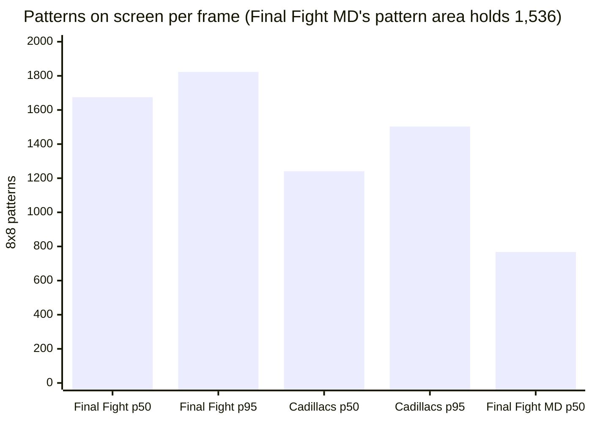
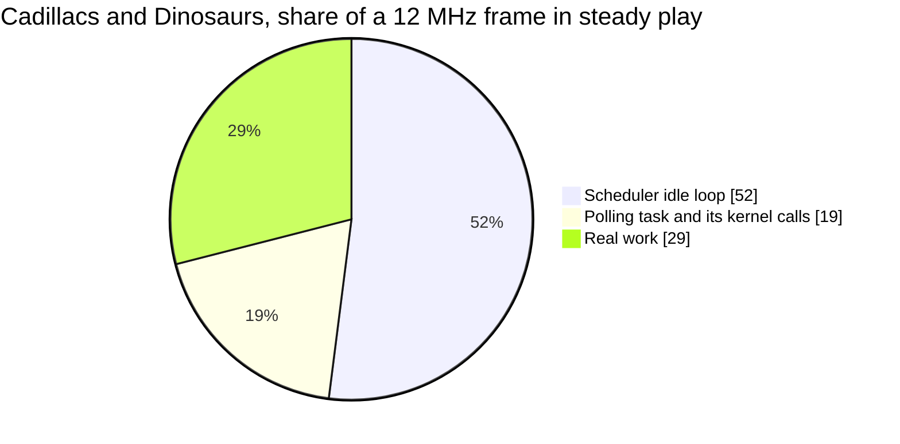
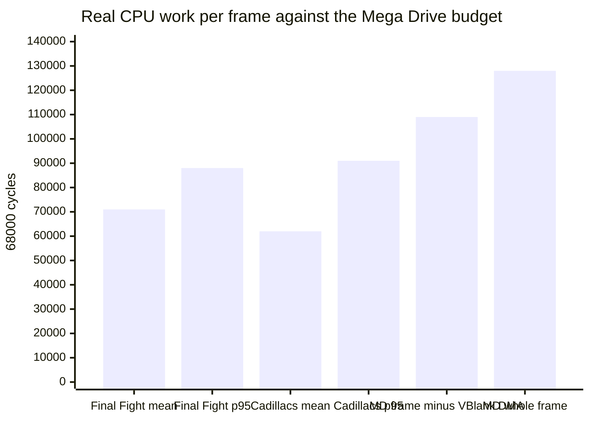

# Cadillacs and Dinosaurs, measured

What the arcade game puts on screen and how hard it works its CPU, measured with the same tools as Final Fight in [doc 02](02-final-fight-arcade-vs-md.md), and what that means for the Mega Drive port. Hardware background is in [doc 01](01-architecture-cps1-vs-mega-drive.md).

## Method

- **ROM:** *Cadillacs and Dinosaurs* (World 930201), MAME set `dino`, plus MAME's QSound device ROM (`qsound.zip`), both supplied by the user.
- **Run:** MAME 0.289 with `tools/mame/cps1_trace.lua`, 21,600 frames (6 minutes), the same input script as the Final Fight run: insert coin, start, walk right in bursts, fight in bursts.
- **Coverage:** stage 1 only, twice: the rooftop start, the mansion interior and the boss room, a game over, a continue and a restart.
- **Frames counted:** 20,163 frames that have sprites and a street-layer picture. This includes the short dialogue, game-over and continue screens. The Final Fight figures quoted for comparison are its 15,170 outdoor gameplay frames from doc 02, so the two columns are close but not identically filtered.

Everything here is stage 1 under scripted play. Later stages (vehicles, larger dinosaurs, more enemies) may be heavier. Counts cover the full 384-pixel-wide arcade picture.

The CPU figures come from a sampling profiler (`tools/mame/cps1_profile.lua`): about 200 samples of the program counter per frame, each classed as real work or not. With 200 samples a single frame's figure is good to about ±7,000 cycles, so the high percentiles are slightly overstated; averages over thousands of frames are solid.

## 1. At a glance

| Per frame | Final Fight arcade | Cadillacs and Dinosaurs arcade |
|---|---|---|
| CPU clock (MAME) | 10 MHz | 12 MHz |
| Sprite tiles on screen (median / p95 / max) | 135 / 208 / 225 | 69 / 134 / 286 |
| Sprite list entries (median) | 135 | 22 |
| Tiles per entry | 1.0 | 2.8 |
| Frames with a line over 320 sprite pixels | 87% | 30% |
| Palettes in use (median) | 25 | 16 |
| Graphics on screen, in 8×8 patterns (median / p95) | 1,675 / 1,823 | 1,241 / 1,503 |
| Frames showing more than 1,536 patterns | 87% | 2% |
| Real CPU work (mean) | 71,000 cycles, 42% of its frame | 65,000 cycles, 32% of its frame |
| Real CPU work in steady play (mean / p95) | 71,000 / 88,000 | 62,000 / 91,000 |
| Frames needing more than a Mega Drive frame (128,000 cycles) | 0% | 2.5%, all in bursts |

Graphics are an easier fit than Final Fight's, and in steady play the game's own code needs about half of a Mega Drive frame.

## 2. Sprites

| Cadillacs and Dinosaurs, per frame | mean | p50 | p95 | p99 | max |
|---|---|---|---|---|---|
| Sprite list entries | 27 | 22 | 54 | 69 | 98 |
| Sprite tiles (16×16) | 75 | 69 | 134 | 158 | 286 |
| Distinct tiles | 59 | 51 | 108 | — | 248 |
| Tiles on the busiest line | 17 | 16 | 29 | 36 | 68 |
| Lines over 320 sprite pixels | 8 | 0 | 47 | 65 | 122 |
| Mega Drive sprites needed, cutting each entry into 32×32 pieces | 40 | 33 | 78 | 94 | 159 |

- **The game uses multi-tile sprite blocks.** No frame was made of single-tile entries only; on average an entry is a block of 2.8 tiles. Final Fight uses one tile per entry. Blocks are regular rectangles, so cutting them into Mega Drive sprites of up to 32×32 can be done mechanically from the sprite list.
- **Half the sprite load of Final Fight.** 69 tiles at the median against 135.
- **The limits still bite.** A direct block-by-block conversion needs more than the Mega Drive's 80 sprites in 2.3% of frames, and 30% of frames have at least one line over the 320-pixel limit. The port needs the same answers Final Fight MD uses: pieces cut to skip empty space, static objects moved to a background plane, and flicker by rotation when a line overflows.
- The sprite list changes in 90% of frames, so the Mega Drive sprite table has to be rebuilt nearly every frame.

## 3. Layers and colour

The layer order register reads `0x12D6` in 98% of frames: scroll 3 at the back, then scroll 2, sprites, and scroll 1 in front, the same order as Final Fight. In 332 frames it reads `0x06D6`, which puts sprites in front of scroll 1.

| Layer | Distinct tiles (median / p95) | Palettes (median / max) |
|---|---|---|
| Scroll 1, 8×8 (HUD, text) | 50 / 73 | 5 / 8 |
| Scroll 2, 16×16 (playfield) | 113 / 140 | 6 / 9 |
| Scroll 3, 32×32 (background) | 48 / 48 | 2 / 6 |
| Sprites | 51 / 108 | 4–5 on average / 10 |
| **All** | | **16 / 22** |

- **Fewer palettes than Final Fight** (16 against 25 at the median), spread more evenly. The background layers together use about 8, where Final Fight's street layer alone used 13.
- **About 160 distinct colours** across the palettes in use (median 161, maximum 205), counted as 12-bit RGB without the brightness nibble. The Mega Drive shows 61. The per-scene palette merge described in doc 02 is still required, but it starts from a smaller set.
- **Tiles in front of sprites are rare.** Scroll 2 cells with a priority group set appear in 3% of frames, up to 64 cells at a time. These are the candidates for high-priority plane cells.

Which layer carries what (HUD, floor, far background) is taken from the layer order and tile sizes; we have not rendered the layers separately yet.

## 4. Graphics on screen

| Cadillacs and Dinosaurs, per frame | mean | p50 | p95 | p99 | max |
|---|---|---|---|---|---|
| Patterns on screen (8×8, non-blank) | 1,095 | 1,241 | 1,503 | 1,555 | 1,834 |
| New since the previous frame | 22 | 8 | 75 | — | 656 |
| Uploads needed with a 1,400-pattern cache | 14 | 0 | 60 | 104 | 656 |

- **A typical frame already fits.** Final Fight MD's pattern area holds 1,536 patterns; only 2% of Cadillacs frames show more than that, against 87% of Final Fight's. A third of frames exceed 1,400.
- **Fit is not the same as comfortable.** Final Fight MD keeps about 630 slots of headroom for animation frames that are loaded but not on screen. Showing a 320-pixel-wide view removes about a sixth of each layer, which buys some of that back; some background reduction per scene will still be needed.
- **Bandwidth is fine.** With a VRAM-sized cache, the 95th-percentile frame needs 60 new patterns and 31 frames in the whole run needed more than the roughly 230 one VBlank can carry, most likely at scene changes.

## 5. CPU time

Cadillacs and Dinosaurs runs on the 12 MHz board, which gives it 201,000 cycles per frame. A Mega Drive frame is 128,000 cycles, or about 109,000 if the CPU is frozen for a full VBlank DMA.

### 5.1 What counts as work

The scheduler's idle loop is not the only place the arcade program waits. One task (slot 15, code at `0x9E38C`) does nothing but check a fast-forward condition (both buttons held in certain states) and yield, thousands of times a second. Together with the kernel calls it makes, it uses about 19% of every frame. Final Fight has the same kind of task in slot 11 (`0x4A8E`), which also polls two work queues.

Where the frame goes in steady play (1.65 million samples over 8,181 frames):

On the Mega Drive the polling task only needs to run once per frame, so its cost disappears. An earlier version of this document counted it as work and concluded the CPU budget was nearly exhausted; that was wrong.

### 5.2 Real work per frame

| Cycles of real work per frame | mean | p50 | p95 | p99 | max |
|---|---|---|---|---|---|
| Cadillacs and Dinosaurs, all frames | 65,000 | 62,000 | 97,000 | 185,000 | 201,000 |
| Cadillacs and Dinosaurs, outside bursts | 62,000 | 62,000 | 91,000 | 102,000 | — |
| Final Fight (10 MHz), gameplay | 71,000 | 73,000 | 88,000 | 95,000 | 116,000 |

- **Steady play fits with room to spare.** The average frame needs 62,000 cycles, about half of a Mega Drive frame. At the 95th percentile it needs 91,000, leaving 37,000 (18,000 if a full VBlank DMA also runs). Only 0.3% of steady frames need more than 109,000.
- **Load follows the sprite count:** 47,000 cycles with fewer than 40 sprite tiles on screen, 59,000 with 40–80, 70,000 with 80–120, 84,000 with 120–160.
- **Bursts are real.** 2.5% of frames need more than a whole Mega Drive frame, and in those the arcade program uses its entire 12 MHz frame. They come in about a dozen runs of 15–115 frames that recur at the same points after each game start (around the character select, the stage intro, the dialogue scene, the continue screen). We read them as scene set-up and non-interactive screens; that needs confirming run by run.

### 5.3 Where the real work goes

Shares of real work in steady play, by routine, counting a routine whenever it is on the call stack:

| Routine | Share | What it is (from the disassembly) |
|---|---|---|
| `0xE90E` | 48% | The per-frame game loop: calls each subsystem in turn |
| `0x13FA6` | 24% | **Sprite list builder.** Picks the back buffer, sorts the draw list by depth with a bubble sort, calls `0x141F8` per object to write sprite entries, ends the list, flips the buffer |
| `0x141F8` | 16% | Writes one object's sprite entries (inside the 24% above) |
| `0x23420` | 21% | Update loop over 24 objects of 224 bytes, each dispatched through a state jump table (enemies, by its position in RAM) |
| `0x18834`, `0x10546`, `0x18952` | 6–7% each | Not yet identified |
| `0x233C6` | 5% | Update loop over 24 objects of 192 bytes |
| VBlank handler `0x542` | 2% | Hardware updates, inputs, sound queue |

The object dispatcher at `0xA954` is on the stack in 87% of real-work samples: nearly everything runs as object handlers.

**The sprite list builder is the single largest item, about a quarter of real work (roughly 15,000 cycles a frame).** It is also exactly the code the port has to replace, because it writes the arcade's sprite format. A replacement that writes Mega Drive sprites directly costs nothing extra if it is no slower than the original.

## 6. Consequences for the port

1. **Running Capcom's code at 60 fps looks feasible in steady play.** Its real work averages about half of a Mega Drive frame, leaving 47,000–66,000 cycles for the port's own video work, and 18,000–37,000 at the 95th percentile.
2. **Run the polling task once per frame.** It is the cheapest saving available: about 19% of the arcade frame for one patch.
3. **Replace the sprite list builder first.** A quarter of real work, and it has to be rewritten anyway. Its depth sort is a bubble sort and could be made cheaper at the same time.
4. **Sprites convert mechanically.** Blocks of 2.8 tiles on average can be cut into 32×32 pieces from the list itself, with rules for the 2% of frames over 80 sprites and the 30% with an over-full line.
5. **VRAM is less of a fight than in Final Fight.** A typical frame fits; the work is headroom and palettes, not wholesale background cuts.
6. **Palettes: 16 into 4.** Same per-scene method as Final Fight MD, from a smaller starting set.
7. **Expect slowdown in the bursts.** There the arcade program itself fills its whole 12 MHz frame, so those moments cannot be matched cycle for cycle. If they are scene set-up and non-interactive screens, running them slower is acceptable.

## 7. Checking the port in an emulator

- **Automated checks: MAME's Mega Drive driver.** It runs headless, takes scripted pad input, saves snapshots, and our Lua script decodes every VDP write. `tools/check_md.sh <rom> <out dir>` runs a ROM for a set number of frames and reports whether the CPU is running or stuck in an exception handler, the picture width, sprites, colours, the largest per-frame DMA and any sprite-limit overflow.
- **Playing and timing accuracy: BlastEm 1.0.0.** It is the usual reference for VDP timing and has a debugger, but it needs a window, so it is for hands-on testing, not automated runs.
- **Real hardware or a flash cart** remains the final check for DMA timing and sound.

## 8. Open items

- **Identify the remaining hot routines** (`0x18834`, `0x10546`, `0x18952`) and the object classes behind the two update loops.
- **Classify the bursts:** which fall in live play, which in cutscenes, loading and menus.
- **Later stages:** the same trace for every stage, especially the driving stage and the large bosses.
- **Layer renders:** render scroll 1, 2 and 3 separately to confirm what each carries and to see the tiles that draw in front of sprites.
- **Palette detail:** which palettes each scene uses and how many colours they really share, as input to the per-scene merge.
- **Work RAM use:** how much of the 64 KB the game leaves free for the port's own tables.
- **Code coverage:** log executed addresses during these runs and feed them to Ghidra, to map the code its static analysis missed.
