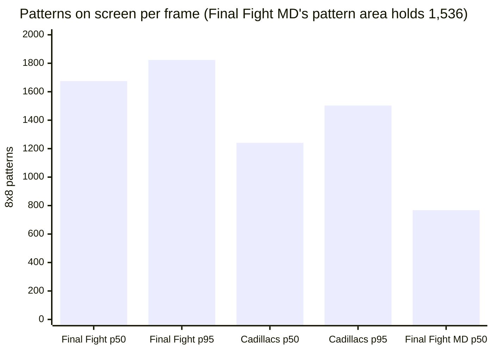
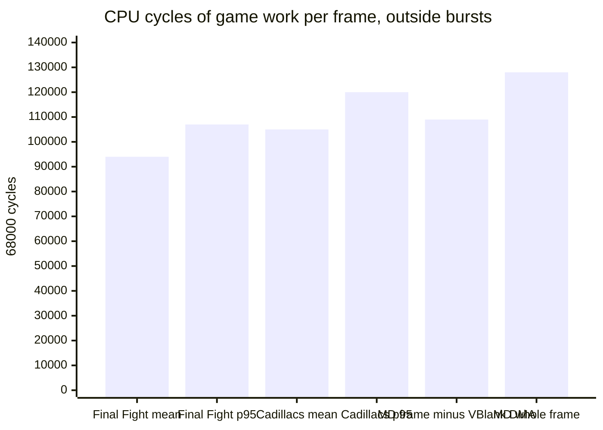

# Cadillacs and Dinosaurs, measured

What the arcade game puts on screen and how hard it works its CPU, measured with the same tools as Final Fight in [doc 02](02-final-fight-arcade-vs-md.md), and what that means for the Mega Drive port. Hardware background is in [doc 01](01-architecture-cps1-vs-mega-drive.md).

## Method

- **ROM:** *Cadillacs and Dinosaurs* (World 930201), MAME set `dino`, plus MAME's QSound device ROM (`qsound.zip`), both supplied by the user.
- **Run:** MAME 0.289 with `tools/mame/cps1_trace.lua`, 21,600 frames (6 minutes), the same input script as the Final Fight run: insert coin, start, walk right in bursts, fight in bursts.
- **Coverage:** stage 1 only, twice: the rooftop start, the mansion interior and the boss room, a game over, a continue and a restart.
- **Frames counted:** 20,163 frames that have sprites and a street-layer picture. This includes the short dialogue, game-over and continue screens. The Final Fight figures quoted for comparison are its 15,170 outdoor gameplay frames from doc 02, so the two columns are close but not identically filtered.

Everything here is stage 1 under scripted play. Later stages (vehicles, larger dinosaurs, more enemies) may be heavier. Counts cover the full 384-pixel-wide arcade picture.

The CPU figures are estimates: we count how often the game's scheduler polled for the next frame (97.5 cycles per poll, from instruction timings) and treat the rest of the frame as work.

## 1. At a glance

| Per frame | Final Fight arcade | Cadillacs and Dinosaurs arcade |
|---|---|---|
| CPU clock (MAME) | 10 MHz | 12 MHz |
| Sprite tiles on screen (median / p95 / max) | 135 / 208 / 225 | 69 / 134 / 286 |
| Sprite list entries (median) | 135 | 22 |
| Tiles per entry | 1.0 | 2.8 |
| Frames with a line over 320 sprite pixels | 87% | 30% |
| Palettes in use (median) | 25 | 16 |
| Graphics on screen, in 8×8 patterns (median / p95) | 1,675 / 1,823 | 1,241 / 1,503 |
| Frames showing more than 1,536 patterns | 87% | 2% |
| CPU work (mean) | 94,000 cycles, 56% of its frame | 108,000 cycles, 54% of its frame |
| Frames needing more than a Mega Drive frame (128,000 cycles) | 0% | 6% in all; 0.1% outside bursts |

Graphics are an easier fit than Final Fight's. CPU time is tighter.

## 2. Sprites

| Cadillacs and Dinosaurs, per frame | mean | p50 | p95 | p99 | max |
|---|---|---|---|---|---|
| Sprite list entries | 27 | 22 | 54 | 69 | 98 |
| Sprite tiles (16×16) | 75 | 69 | 134 | 158 | 286 |
| Distinct tiles | 59 | 51 | 108 | — | 248 |
| Tiles on the busiest line | 17 | 16 | 29 | 36 | 68 |
| Lines over 320 sprite pixels | 8 | 0 | 47 | 65 | 122 |
| Mega Drive sprites needed, cutting each entry into 32×32 pieces | 40 | 33 | 78 | 94 | 159 |

- **The game uses multi-tile sprite blocks.** No frame was made of single-tile entries only; on average an entry is a block of 2.8 tiles. Final Fight uses one tile per entry. Blocks are regular rectangles, so cutting them into Mega Drive sprites of up to 32×32 can be done mechanically from the sprite list.
- **Half the sprite load of Final Fight.** 69 tiles at the median against 135.
- **The limits still bite.** A direct block-by-block conversion needs more than the Mega Drive's 80 sprites in 2.3% of frames, and 30% of frames have at least one line over the 320-pixel limit. The port needs the same answers Final Fight MD uses: pieces cut to skip empty space, static objects moved to a background plane, and flicker by rotation when a line overflows.
- The sprite list changes in 90% of frames, so the Mega Drive sprite table has to be rebuilt nearly every frame.

## 3. Layers and colour

The layer order register reads `0x12D6` in 98% of frames: scroll 3 at the back, then scroll 2, sprites, and scroll 1 in front, the same order as Final Fight. In 332 frames it reads `0x06D6`, which puts sprites in front of scroll 1.

| Layer | Distinct tiles (median / p95) | Palettes (median / max) |
|---|---|---|
| Scroll 1, 8×8 (HUD, text) | 50 / 73 | 5 / 8 |
| Scroll 2, 16×16 (playfield) | 113 / 140 | 6 / 9 |
| Scroll 3, 32×32 (background) | 48 / 48 | 2 / 6 |
| Sprites | 51 / 108 | 4–5 on average / 10 |
| **All** | | **16 / 22** |

- **Fewer palettes than Final Fight** (16 against 25 at the median), spread more evenly. The background layers together use about 8, where Final Fight's street layer alone used 13.
- **About 160 distinct colours** across the palettes in use (median 161, maximum 205), counted as 12-bit RGB without the brightness nibble. The Mega Drive shows 61. The per-scene palette merge described in doc 02 is still required, but it starts from a smaller set.
- **Tiles in front of sprites are rare.** Scroll 2 cells with a priority group set appear in 3% of frames, up to 64 cells at a time. These are the candidates for high-priority plane cells.

Which layer carries what (HUD, floor, far background) is taken from the layer order and tile sizes; we have not rendered the layers separately yet.

## 4. Graphics on screen

| Cadillacs and Dinosaurs, per frame | mean | p50 | p95 | p99 | max |
|---|---|---|---|---|---|
| Patterns on screen (8×8, non-blank) | 1,095 | 1,241 | 1,503 | 1,555 | 1,834 |
| New since the previous frame | 22 | 8 | 75 | — | 656 |
| Uploads needed with a 1,400-pattern cache | 14 | 0 | 60 | 104 | 656 |

- **A typical frame already fits.** Final Fight MD's pattern area holds 1,536 patterns; only 2% of Cadillacs frames show more than that, against 87% of Final Fight's. A third of frames exceed 1,400.
- **Fit is not the same as comfortable.** Final Fight MD keeps about 630 slots of headroom for animation frames that are loaded but not on screen. Showing a 320-pixel-wide view removes about a sixth of each layer, which buys some of that back; some background reduction per scene will still be needed.
- **Bandwidth is fine.** With a VRAM-sized cache, the 95th-percentile frame needs 60 new patterns and 31 frames in the whole run needed more than the roughly 230 one VBlank can carry, most likely at scene changes.

## 5. CPU time

Cadillacs and Dinosaurs runs on the 12 MHz board, which gives it 201,000 cycles per frame.

| Cadillacs and Dinosaurs, per frame | mean | p50 | p95 | p99 | max |
|---|---|---|---|---|---|
| Share of the frame spent working, all frames | 54% | 53% | 64% | 96% | 100% |
| Cycles, all frames | 108,000 | 107,000 | 130,000 | 193,000 | 201,000 |
| Cycles, outside bursts | 105,000 | 105,000 | 120,000 | 125,000 | — |

**Bursts.** 6% of frames need more than an entire Mega Drive frame (128,000 cycles). They are not spread evenly: 2,495 frames sit in 20 bursts, the two longest about 10 and 7 seconds. The bursts recur at the same points after each game start, and the snapshots nearest the long ones show a dialogue scene and the continue screen. We read them as scene set-up, cutscenes and screens where the game is not being played, where slowing down would not be felt. That reading needs confirming burst by burst.

**Steady play.** Outside the bursts (17,668 frames):

- The game's own work averages 105,000 cycles and reaches 120,000 at the 95th percentile.
- Only 0.1% of frames exceed a Mega Drive frame.
- 31% exceed 109,000 cycles, which is what is left of a Mega Drive frame when the CPU is frozen for a full VBlank DMA.
- Load rises with sprites on screen: 48% of the frame with fewer than 40 sprite tiles, 59% with 120 or more.

**What this means.** Capcom's code, unchanged, would just about fit a Mega Drive frame during play, leaving roughly 23,000 cycles on average and 8,000 in busy moments. That is not enough for the work the port adds: rebuilding the sprite table, feeding tilemap changes to the planes, and managing VRAM. A 60 fps port that keeps the original code therefore has to make the code cheaper, not only the graphics.

## 6. Consequences for the port

1. **Keep the plan to run Capcom's code, but budget for replacing parts of it.** The prime candidates are the routines that only build arcade video tables (sprite list, tilemap writers, palette writers). Writing Mega Drive data directly from those routines removes both their arcade cost and a separate translation pass.
2. **Profile before choosing.** We know how much time the game uses per frame, not where it goes. The next measurement is a per-routine profile of steady play.
3. **Sprites convert mechanically.** Blocks of 2.8 tiles on average can be cut into 32×32 pieces from the list itself, with rules for the 2% of frames over 80 sprites and the 30% with an over-full line.
4. **VRAM is less of a fight than in Final Fight.** A typical frame fits; the work is headroom and palettes, not wholesale background cuts.
5. **Palettes: 16 into 4.** Same per-scene method as Final Fight MD, from a smaller starting set.
6. **Allow slowdown where the arcade is already saturated.** In the bursts the arcade program itself uses its whole 12 MHz frame, so those moments cannot be matched cycle for cycle; if they are cutscenes and menus, running them slower is acceptable.

## 7. Open items

- **Per-routine CPU profile** of steady play, to find what to replace.
- **Classify the bursts:** which fall in live play, which in cutscenes, loading and menus.
- **Later stages:** the same trace for every stage, especially the driving stage and the large bosses.
- **Layer renders:** render scroll 1, 2 and 3 separately to confirm what each carries and to see the tiles that draw in front of sprites.
- **Palette detail:** which palettes each scene uses and how many colours they really share, as input to the per-scene merge.
- **Work RAM use:** how much of the 64 KB the game leaves free for the port's own tables.
- **Code coverage:** log executed addresses during these runs and feed them to Ghidra, to map the code its static analysis missed.
