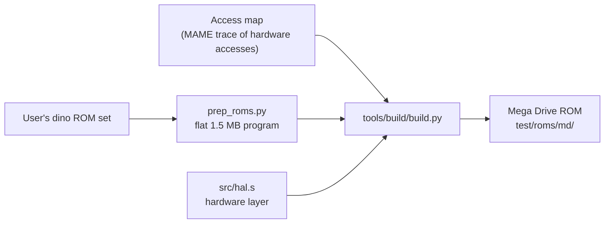

# Port plan

How *Cadillacs and Dinosaurs* gets from the arcade board to a Mega Drive cartridge, in milestones. It builds on the measurements in [doc 01](01-architecture-cps1-vs-mega-drive.md), [doc 02](02-final-fight-arcade-vs-md.md) and [doc 03](03-cadillacs-and-dinosaurs-measured.md).

## Decisions

| Decision | Choice | Why |
|---|---|---|
| Game code | Capcom's original 68000 program, run in place | Same CPU, same RAM address; logic is then identical by construction. Its real work fits half a Mega Drive frame in steady play |
| New code | 68000 assembly, GNU binutils (`m68k-elf-as`, `m68k-elf-ld`) | The arcade code has fixed register roles, its own kernel and interrupt handler; a C runtime such as SGDK would fight all three |
| Game data | Taken from the user's ROM set at build time | The repository holds no Capcom data; built ROMs are never committed |
| Reference for video | Final Fight MD's recipe (doc 02) | Proven layer mapping, palette plan, sprite cutting and VRAM layout |
| Emulator for checks | MAME `genesis`, headless | Scriptable; BlastEm for hands-on play |

vasm was the first choice of assembler; GNU binutils is used because it installs from Homebrew.

## How the build works



`tools/build/build.py` takes the arcade program and:

1. **Redirects fixed-address hardware accesses** to shadow locations in work RAM by rewriting the address operand in place (same instruction, same size): the I/O and video registers at `0x800000`, the sound interface at `0xF18000`, and player 3 and EEPROM at `0xF1C000`. It patches the instructions seen executing in the access map, then any remaining value in those ranges that is the operand of a valid instruction.
2. **Replaces the vector table and the first header page.** Reset and VBlank (level 6) go to the hardware layer; TRAP vectors stay Capcom's, so the kernel runs unchanged.
3. **Skips the power-on self-test**, which reads back arcade video RAM, and enters the game's start-up directly.
4. **Appends the hardware layer** after the program at `0x180000`.

The hardware layer (`src/hal.s`) boots the console, and on every VBlank fills the shadow input ports from the pad and then jumps into Capcom's own VBlank handler.

### Memory

| Arcade | Mega Drive build |
|---|---|
| Program `0x000000–0x17FFFF` | Same addresses |
| Work RAM `0xFF0000–0xFFFFFF` | Same addresses |
| I/O and video registers `0x800000–0x8001FF` | Shadow at `0xFF1000` |
| Sound interface `0xF18000–0xF1803F` | Shadow at `0xFF1200` |
| Player 3, EEPROM `0xF1C000–0xF1C01F` | Shadow at `0xFF1280` |
| Sprite lists `0x900000`, `0x904000` | RAM buffers at `0xFF2000`, `0xFF2800` |
| Palettes `0x914000–0x914FFF` | RAM at `0xFF3000–0xFF3FFF` |
| Playfield map (scroll 2) `0x90C000–0x90FFFF` | Store at `0xFF4000` (64 × 32 cells, 8 KB) |
| Far background map (scroll 3) `0x910000–0x913FFF` | Store at `0xFF6000` (64 × 16 cells, 4 KB) |
| HUD map (scroll 1) and the rest of GFX RAM | Not handled yet (writes dropped) |
| Hardware layer's own data | `0xFF12C0–0xFF1C1F`, stack `0xFF1C20–0xFF1FFF`, cache tables `0xFF7000–0xFF7F7F` |

Measured over stage 1, the game writes 41% of its work RAM after boot and leaves one block of about 28 KB untouched (`0xFF0FD3–0xFF7FFF`). The shadows live there. The game's start-up does clear that block once, so anything the hardware layer keeps there is re-established every frame. Whether later stages use the block is not yet measured.

`0xF18000` matters on real hardware: the Mega Drive mirrors work RAM through `0xE00000–0xFFFFFF`, so an unpatched sound write would land in the game's own variables.

## Milestones

### 1. The arcade program runs on the Mega Drive — done (emulator)

Verified in MAME's Mega Drive driver by reading the game's own state:

- The task kernel runs: same task slots and the same call stacks as the arcade machine at the same point (attract mode, with the polling task in slot 15).
- VBlank drives Capcom's handler, which writes its video registers to the shadow (sprite buffer flipping, scroll positions, layer control changing between scenes).
- Pad input works end to end: A inserts a coin, Start starts, the game enters stage 1, player 1 becomes active, and holding right moves him and scrolls the stage; the enemy update loop runs.

Not done in this milestone: any picture or sound, GFX RAM (writes go nowhere, reads return nothing useful), and safety on real hardware (unpatched GFX RAM accesses would hang a real console).

### 2. Sprites

- **Done (emulator):** the sprite list builder (`0x13FA6`) and the list-clearing routine write to two RAM buffers at `0xFF2000` and `0xFF2800` in place of arcade video RAM (four address operands).
- **Done (emulator):** outlines, as a first check of positions, sizes and order.
- **Done (emulator): real sprite graphics.** The title logo, the attract-mode story (portraits, the Cadillac, the raptor), the character select, and stage 1 through to the mansion interior show Capcom's sprite art with correct colours.

How it works:

- **Build time.** Every arcade 16×16 tile in the sprite range is converted to four Mega Drive patterns (pen 15, transparent on the CPS-1, becomes pen 0). A byte per tile records whether it has any pixels. Colour levels are precomputed into a 256-byte table from MAME's brightness formula.
- **Graphics ROM layout.** The arcade graphics ROM is organised by use: tile codes `0x0000–0x07FF` text layer, `0x0800–0x57FF` sprites, `0x5800–0x6FFF` playfield tiles (some also used as sprites), `0x7000–0x7FFF` far background (stage 1 trace). Only `0x0800–0x6FFF` is stored for now: 3.25 MB, giving a 4.8 MB ROM.
- **Per frame**, after Capcom's VBlank handler shows a finished list, the hardware layer walks it once:
  - cuts each block into pieces of two tiles side by side (32×16) where the two tiles are consecutive in ROM, otherwise single tiles (16×16), honouring the block's flips;
  - looks each piece up in a 128-slot, 4-way VRAM cache (1,024 patterns) and queues a DMA from ROM for misses, at most 22 per frame;
  - writes the Mega Drive sprite table in the arcade's order, so the arcade's front-most sprites stay in front;
  - gives sprites three CRAM lines (line 3 belongs to the backgrounds since milestone 3) and converts their palettes to Mega Drive colours. A line keeps its arcade palette while that palette is on screen, unless another covers more than twice its area; palettes without a line use the line whose colours are closest (sum of RGB differences).
- **Next VBlank** it sends the queued tiles, the sprite table and the palettes.
- **The work only happens when the game has finished a new list.** Processing an unterminated list of 256 entries took more than a frame.

Measured in MAME over 100 seconds of attract mode and stage 1 (6,000 frames with sprites):

| Per frame | mean | p50 | p95 | max |
|---|---|---|---|---|
| Hardware sprites | 48 | 46 | 69 | 80 (cap reached in 2.3% of frames) |
| VRAM DMA, bytes | 565 | 448 | 1,696 | 5,760 |
| Colours in CRAM | 44 | 47 | 50 | 51 |

Known problems:

- **Per-line limits.** 30% of frames have a line with more than 320 sprite pixels or 20 sprites, where the VDP drops the pieces latest in the list. The title logo loses letters this way.
- **Palettes.** Stage 1 shows 4 or 5 sprite palettes at once (11 RAM dumps) against two lines, so some sprites use the wrong colours. Picking the two busiest palettes every 8 frames made characters change colour as they moved: the lines swapped up to 66 times in 10 seconds of scripted play. Keeping each line's palette until it leaves the screen brought that to 0–4. The player's palette (0) covers less area than three enemy palettes at the start of stage 1 and never won a line, so palettes 0 to 2 now always win one; in a combo-and-dash test the player then held line 0 for all 440 frames and matches the arcade picture. Enemies beyond the one remaining line still show borrowed colours.
- **VBlank can arrive late.** The arcade kernel raises the interrupt mask to level 6 to shut out its own level-2 VBlank; on the Mega Drive that also delays our level-6 VBlank, and in 2.5% of frames the uploads start after the picture has begun.

Still to do in this milestone:

- Replace the builder with one that writes the Mega Drive sprite table directly (a quarter of the game's CPU work).
- Overflow rules: rotation (flicker) when a line or the 80-sprite total overflows; 32×32 pieces to halve the sprite count.

### 3. Backgrounds and palettes

**Done (emulator): the playfield (scroll 2) on plane B.** The character select artwork, the stage 1 intro scene, and the rooftop floor and walls scroll with the camera under the sprites. The game finishes 51 to 60 sprite lists a second in stage 1 (measured over 50 seconds of scripted play).

What the measurements showed and how it works:

- **The game does not write maps locally.** It fills whole maps at scene changes and prepares columns half a map (32 columns) ahead of the camera, so the planes cannot be fed as it writes. The playfield is kept in a RAM store of 64 columns × 32 rows (8 KB, arcade rows taken mod 32) and drawn from it.
- **The game reads the playfield map back** for floor zones and collision (the top six bits of each attribute word, read by `0x1309C` and `0x1361E`); those reads are served from the store.
- **Plane B is a ring** of 32 arcade columns × 16 rows that follows the camera: a new column is drawn as the camera crosses a column boundary, and a jump of more than 8 columns redraws the ring.
- **Playfield tiles go through a reference-counted VRAM cache** of 128 slots (512 patterns), keyed by tile code and palette in a 256-entry hash table, filled from ROM by CPU copy as cells are drawn.
- **Writes reach the store in three ways:**
  - 122 instructions that touch the playfield through pointers are replaced by `TRAP #8`. The handler looks the instruction up in a build-time hash table, decodes it (MOVE, CLR, AND, OR, any addressing mode) and performs it, sending accesses to arcade video RAM to the store.
  - Three heavy routines (the table clear at `0xBA0`, the 2 × 2 block writer, the long copier) get dedicated traps (#9 to #11).
  - 210 instructions that only touch layers not drawn yet (HUD text, far background) are reduced at build time to their register side effects (`addq` for address increments, a cleared register for reads). The routine at `0xA7B8`, which only fills a table the port drops, returns immediately.
- **The hardware layer runs on its own stack** at `0xFF1C20–0xFF1FFF`. The arcade's supervisor stack (`0xFF0E66`) sits directly above its task stacks and has no room: nesting the trap handler, VBlank and Capcom's VBlank handler overwrote a task's return address.
- **A vertical camera step draws one new row;** only a jump of the window releases every slot and redraws, with the display off meanwhile. Releasing first and redrawing over several frames showed cells pointing at slots already reused: the scrambled floor seen while running.
- **The store folds the map's 64 rows onto 32,** and the game fills the unused half of each column with a blank tile (measured on the arcade: tiles in rows 22–31 and 36–51, blank `0x5800` elsewhere, never two real tiles 32 rows apart). Each store cell has a bit for the half it holds: a blank written to the other half is dropped, and the other half reads back empty.

**Done (emulator): the far background (scroll 3) on plane A,** low priority, behind the playfield: the city skyline, dome and sea of stage 1 scroll at their own speed. 

- It works like the playfield: a RAM store of 64 columns × 16 rows (arcade rows mod 16), a ring of 16 × 8 cells of 32 × 32 pixels on plane A, of which the 11 × 8 the screen can show are drawn, and reference-counted slots of 16 patterns shared through the same hash table (keys are the tile code with bit 15 set).
- **VRAM is short.** Sprites take 512 patterns and the playfield 512; the far background gets 41 slots (656 patterns): 30 in the main pattern area, 6 in window-plane rows the HUD will not use, and 5 in the gaps around the scroll and sprite tables. Measured in 11 RAM dumps of stage 1 play, the 11 × 8 window holds 27 to 48 different far tiles, so the cache ran out and left black cells.
- **Cells the playfield hides get no slot.** The playfield's opaque pixels cover 37–62% of the far background on screen. The build marks each 16 × 16 playfield tile that has no transparent pixel; the playfield renderer keeps one bitmask per ring column of the cells showing such a tile; a far cell is drawn only if the playfield cells over it, widened by 16 pixels to each side, are not all opaque. In the same dumps that brings the tiles needed down to 23–37. After the change the cache kept 4–14 slots free (one sample hit 0 during the opening pan).
- **The layers scroll at different speeds,** so what is hidden changes. When their relative position, the far layer's vertical scroll or a playfield cell changes, a sweep rechecks every far column, two per odd frame (the sprite converter runs on even frames). With the sweep running only after such changes, the game still finishes 43–63 sprite lists a second, the same as without it.

**Done (emulator): one CRAM line for both backgrounds, three for sprites** (`src/bgpal.s`).

- **Need, measured in 11 RAM dumps of stage 1:** the playfield shows 5–8 palettes at once (47–66 distinct 12-bit colours), the far background 2 (23 colours), sprites 4–5 palettes. Showing one palette per layer gave the "negative" building and wrong enemy colours.
- **The backgrounds' colours are reduced to 15 at run time.** The hardware layer counts the palettes of every cell in both stores, lists their distinct colours to Mega Drive precision, and picks 15 by repeatedly taking the colour with the largest distance to those already picked times its use. An offline prototype of the same method on two dumps is close to the arcade picture; with 15 colours per layer it is closer still, but that leaves sprites two lines.
- **Tile pixels are renumbered as they are loaded into VRAM,** through a 16-byte pen map per arcade palette; the three most used palettes get a 256-byte table that converts two pixels at a time (7 instructions per word against about 20).
- **The cache key includes the palette:** the game draws floor shadows by reusing a tile with a darker palette.
- **When it runs:** when a tile with an unmapped palette is written to a store (the game writes about 32 columns ahead of the camera) and when a mapped palette's colours change, checked every 32 frames. A colour that stays keeps its position in the line, and only tiles whose pen map changed are reloaded. In 70 seconds of scripted play it ran 9 times before the game starts and 4 times in stage 1. Each run stalls the game for several frames; the title and select screens run at 13–30 sprite lists a second because of it.
- **The map fill counts for both halves.** The title fills the whole playfield map with one green tile; the half a store cell does not hold reads back as the last fill, not as empty.
- **Sprite cache sets overflow.** The title logo is 56 pieces; 6 were dropped because their 4-way set was full of pieces in use. A piece now falls back to the next set (52 of 56 drawn).
- **Sprites:** a line keeps its palette while it is on screen; the players' palettes always get one. With three lines the player and two enemy palettes are exact in stage 1's first scenes.

The instruction budget is the hard constraint. The Mega Drive's 68000 executes about 13,000 instructions per frame. Measured with MAME's instruction trace on the select screen before these changes, the sprite converter used about 9,500 of them, a trap cost about 170, and Capcom's code got 2%. After them, in stage 1, Capcom's code gets 58%. To get there:

- the sprite converter keeps its loop values in registers and runs on even frames only;
- palette colours are converted only when their arcade value changes;
- trap lookups use a hash table.

**Speed pass** (PC sampled about 160 times a frame over four windows of scripted play, before and after):

- **Tile hash.** With 256 entries and a shift-and-xor hash, the consecutive tile codes of a scene formed long runs: `hash_delete` took 6–9% of the CPU while scenes loaded. A multiplicative hash (code × 40503, plus the palette) removed it from the profile.
- **Pair tables on demand.** Tiles in palettes without a 256-byte table were converted a nibble at a time; a palette now takes over the oldest of the three tables when it needs one.
- **Three game instructions patched in place.** In fights, `TRAP #8` fired about 17 times a frame from three sites: the two collision routines' attribute reads (`0x130EA`, `0x13670`), now a call to a short routine, and a 32-long copy loop into the text layer (`0xCC98`), now two address increments until that layer is drawn.
- **Sprite list conversion follows the game.** It runs only when the game has shown a new list. If the game shows fewer than 24 lists in 32 frames, the gap between conversions grows from two frames to three, and returns to two when it shows 30.
- **Change-list overflow redraws columns, not the window.** While a scene is drawn, more than 64 cells change per frame.
- **Cells that get no slot are retried.** In the opening pan the playfield cache runs out (0 of 128 free); the cells stayed blank until redrawn. They now go back on the change list and fill in within about 40 frames.
- **The palette check runs every 32 frames** instead of 8.

Sprite lists finished per second, same script: opening 20–31 → 44–64; first fights 43–51 → 49–58; later play 56–59 → 59–60. 

**Select-screen load.** While it loaded, 24–51 of every 60 VBlanks were handled. Two changes: after a reduction, only the tiles in VRAM whose palette's pen map changed are loaded again, in place, and no cell is redrawn; and when the game fills a map with a blank tile, the plane is wiped with one VRAM fill and every slot released. In the same five seconds 57, 60, 42, 41 and 60 VBlanks are now handled; what remains is tile loading and the reduction itself.

**Doorway and door scene of stage 1** (scripted play with the player's health, the word at `0xFFB2E0`, held at 100 so the run reaches them; the arcade run with the same script is the reference):

- **The playfield needs up to 137 slots there and had 128** (distinct tile and palette pairs in the window, sampled every 100 frames); cells without a slot showed the layer behind. The window is now 22 columns, and when the playfield runs out it borrows free far background slots, four playfield tiles each, up to eight; the far background takes back a group once none of its four is in use. Indoors the far background uses no slots at all.
- **Most palette changes no longer choose the line again.** A new palette whose 15 colours are each within a squared distance of 24 (in doubled Mega Drive steps) of a line colour gets a pen map and nothing else is touched. Before, the door's palette alone made the line be chosen again and nearly every tile reloaded: `remap_copy` took 12–18% of the CPU in those stretches.
- **Sprite lines:** a palette takes over a line when it covers a quarter more area than the line's (was twice). The enemy who walks out of the door fades in from dark; it is the fourth sprite palette on screen, so it borrows a line, and the borrowed line is now chosen again every 16 conversions instead of once while the palette was still dark.
- **The conversion gap** now moves between two and four frames.
- Sprite lists per second through the doorway: 36–51 before, 54–62 after. In the brawl that follows (six enemies) the game's own code takes 44% of the CPU and the sprite converter 25%; it runs at 42–58.

Still to do:

- The text layer (scroll 1) in the window: the HUD, and all the text and player panels of the title and select screens. Its writes are currently dropped. VRAM and the hardware layer's RAM are both full, so it needs room made first.
- Palettes: the reduction stalls the game when it runs and is visible for a few frames in play; the title and select screens need it tuned.
- Sprites at 60 Hz again, by replacing Capcom's sprite list builder instead of converting its output.

### 4. Sound

- Take over the sound command queue (one routine in the VBlank handler).
- Z80 driver with FM music re-arranged from the QSound sequences and PCM effects.

### 5. Real hardware

- Every GFX RAM access patched or redirected, with the access map extended to all stages.
- Sega mapper for the ROM beyond 4 MB; settings in battery RAM in place of the EEPROM.
- Run the polling task once per frame.
- Checks in BlastEm and on a console.

### 6. Whole game

- Traces and tuning for every stage, three players through a multitap, the slow bursts at scene changes.

## Open problems

- **Where the HUD map lives.** Scroll 1 is 16 KB and does not fit beside the game in work RAM; the playfield and far background fit because the game uses only part of their maps (64 × 32 and 64 × 16 cells). The HUD needs the same measurement.
- **The access map is incomplete.** It comes from one stage-1 play-through, and it missed at least one start-up instruction that reads a DIP switch (found only when the Mega Drive build went into test mode). Static patching covers that case; code that reaches hardware through pointers in unvisited stages is still unknown.
- **Free RAM across the whole game.** The 28 KB block is a stage-1 result.
- **CPU bursts.** Whether the saturated moments are all non-interactive.

## Trying a build

Built ROMs go to `test/roms/md/`, which git ignores because they contain the user's game program. Build with `build_md.py` (see the README), which reads `dino.zip` and the patch-site list `tools/build/dino_access.csv` (the instruction addresses from the stage-1 access map, without counts):

```sh
analysis/venv/bin/python3 -I build_md.py dino.zip test/roms/md/cadillacs_md.md
tools/run_md.sh test/roms/md/cadillacs_md.md analysis/mame/run      # MAME with the mapper, in a window
TRACE_INPUT=arcade tools/check_md.sh test/roms/md/cadillacs_md.md analysis/mame/check 7200 600
```

Pad: A = coin, Start = start, B = attack, C = jump.

The ROM is 6 MB and uses the Sega/Krikzz SSF mapper, which its header announces (`SEGA SSF`). MAME enables bank switching only for a software-list entry: `tools/run_md.sh` writes one with slot type `rom_titan` (the Krikzz SSF mapper, 32 banks); MAME 0.289's `rom_ssf2` type implements only the 10 banks Super Street Fighter II used. Other emulators and flash carts read the header.

The current build (0.1.0-alpha) shows the sprites, the playfield and the far background. There is no HUD or sound; the known issues are listed in the README. It has been run in emulators only.
