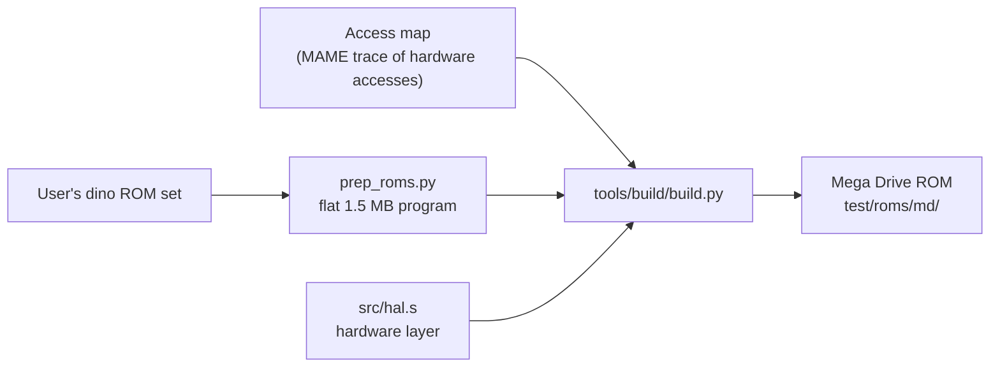

# Port plan

How *Cadillacs and Dinosaurs* gets from the arcade board to a Mega Drive cartridge, in milestones. It builds on the measurements in [doc 01](01-architecture-cps1-vs-mega-drive.md), [doc 02](02-final-fight-arcade-vs-md.md) and [doc 03](03-cadillacs-and-dinosaurs-measured.md).

## Decisions

| Decision | Choice | Why |
|---|---|---|
| Game code | Capcom's original 68000 program, run in place | Same CPU, same RAM address; logic is then identical by construction. Its real work fits half a Mega Drive frame in steady play |
| New code | 68000 assembly, GNU binutils (`m68k-elf-as`, `m68k-elf-ld`) | The arcade code has fixed register roles, its own kernel and interrupt handler; a C runtime such as SGDK would fight all three |
| Game data | Taken from the user's ROM set at build time | The repository holds no Capcom data; built ROMs are never committed |
| Reference for video | Final Fight MD's recipe (doc 02) | Proven layer mapping, palette plan, sprite cutting and VRAM layout |
| Emulator for checks | MAME `genesis`, headless | Scriptable; BlastEm for hands-on play |

vasm was the first choice of assembler; GNU binutils is used because it installs from Homebrew.

## How the build works



`tools/build/build.py` takes the arcade program and:

1. **Redirects fixed-address hardware accesses** to shadow locations in work RAM by rewriting the address operand in place (same instruction, same size): the I/O and video registers at `0x800000`, the sound interface at `0xF18000`, and player 3 and EEPROM at `0xF1C000`. It patches the instructions seen executing in the access map, then any remaining value in those ranges that is the operand of a valid instruction.
2. **Replaces the vector table and the first header page.** Reset and VBlank (level 6) go to the hardware layer; TRAP vectors stay Capcom's, so the kernel runs unchanged.
3. **Skips the power-on self-test**, which reads back arcade video RAM, and enters the game's start-up directly.
4. **Appends the hardware layer** after the program at `0x180000`.

The hardware layer (`src/hal.s`) boots the console, and on every VBlank fills the shadow input ports from the pad and then jumps into Capcom's own VBlank handler.

### Memory

| Arcade | Mega Drive build |
|---|---|
| Program `0x000000–0x17FFFF` | Same addresses |
| Work RAM `0xFF0000–0xFFFFFF` | Same addresses |
| I/O and video registers `0x800000–0x8001FF` | Shadow at `0xFF1000` |
| Sound interface `0xF18000–0xF1803F` | Shadow at `0xFF1200` |
| Player 3, EEPROM `0xF1C000–0xF1C01F` | Shadow at `0xFF1280` |
| Sprite lists `0x900000`, `0x904000` | RAM buffers at `0xFF2000`, `0xFF2800` |
| Rest of GFX RAM `0x908000–0x92FFFF` | Not handled yet (milestone 3) |

Measured over stage 1, the game writes 41% of its work RAM after boot and leaves one block of about 28 KB untouched (`0xFF0FD3–0xFF7FFF`). The shadows live there. The game's start-up does clear that block once, so anything the hardware layer keeps there is re-established every frame. Whether later stages use the block is not yet measured.

`0xF18000` matters on real hardware: the Mega Drive mirrors work RAM through `0xE00000–0xFFFFFF`, so an unpatched sound write would land in the game's own variables.

## Milestones

### 1. The arcade program runs on the Mega Drive — done (emulator)

Verified in MAME's Mega Drive driver by reading the game's own state:

- The task kernel runs: same task slots and the same call stacks as the arcade machine at the same point (attract mode, with the polling task in slot 15).
- VBlank drives Capcom's handler, which writes its video registers to the shadow (sprite buffer flipping, scroll positions, layer control changing between scenes).
- Pad input works end to end: A inserts a coin, Start starts, the game enters stage 1, player 1 becomes active, and holding right moves him and scrolls the stage; the enemy update loop runs.

Not done in this milestone: any picture or sound, GFX RAM (writes go nowhere, reads return nothing useful), and safety on real hardware (unpatched GFX RAM accesses would hang a real console).

### 2. Sprites

- **Done (emulator):** the sprite list builder (`0x13FA6`) and the list-clearing routine write to two RAM buffers at `0xFF2000` and `0xFF2800` in place of arcade video RAM (four address operands).
- **Done (emulator):** outlines. Every VBlank the hardware layer reads the finished list and draws each entry as boxes, one Mega Drive sprite per 32×32 piece of the tile block, coloured by the low two bits of the arcade palette number. The title logo, the four characters on the select screen and the characters in stage 1 appear as moving silhouettes. The view is the middle 320 pixels of the arcade's 384. Only the first 79 pieces are drawn and nothing is done about the per-line limit yet.
- Then real graphics: convert tiles from the user's ROM at build time, cut blocks into pieces of up to 32×32, load patterns through a VRAM cache and a DMA queue.
- Replace the builder with one that writes the Mega Drive sprite table directly (a quarter of the game's CPU work).
- Overflow rules for more than 80 sprites and more than 320 pixels on a line.

### 3. Backgrounds and palettes

- Scroll 2 to plane B, scroll 3 to plane A, scroll 1 (HUD) to the window, following doc 02.
- Keep copies of the tables the game reads back (scroll 2 map and palettes) in RAM; send the others straight to VRAM.
- Per-scene palette plans made offline: 16 arcade palettes into 4.
- 320-pixel view of the 384-pixel layout.

### 4. Sound

- Take over the sound command queue (one routine in the VBlank handler).
- Z80 driver with FM music re-arranged from the QSound sequences and PCM effects.

### 5. Real hardware

- Every GFX RAM access patched or redirected, with the access map extended to all stages.
- Sega mapper for the ROM beyond 4 MB; settings in battery RAM in place of the EEPROM.
- Run the polling task once per frame.
- Checks in BlastEm and on a console.

### 6. Whole game

- Traces and tuning for every stage, three players through a multitap, the slow bursts at scene changes.

## Open problems

- **Where the tilemaps live.** Scroll 1 and scroll 3 are 16 KB each and do not fit beside the game in work RAM. The plan is to translate their writes straight into VRAM, which means understanding the 330 or so instructions that write them through pointers.
- **The access map is incomplete.** It comes from one stage-1 play-through, and it missed at least one start-up instruction that reads a DIP switch (found only when the Mega Drive build went into test mode). Static patching covers that case; code that reaches hardware through pointers in unvisited stages is still unknown.
- **Free RAM across the whole game.** The 28 KB block is a stage-1 result.
- **CPU bursts.** Whether the saturated moments are all non-interactive.

## Trying a build

Built ROMs go to `test/roms/md/`, which git ignores because they contain the user's game program. Build with:

```sh
analysis/venv/bin/python3 -I tools/build/build.py analysis/work/dino_prg.bin \
  analysis/mame/dino_access/access_pcs.csv test/roms/md/cadillacs_md.bin
```

Pad: A = coin, Start = start, B = attack, C = jump.

The current build shows sprite outlines on a blue background and has no backgrounds, real graphics or sound. It has been run in MAME's Mega Drive driver only. Do not run it on a real console or flash cart yet: it still writes to arcade video RAM addresses, which a real Mega Drive does not tolerate.
