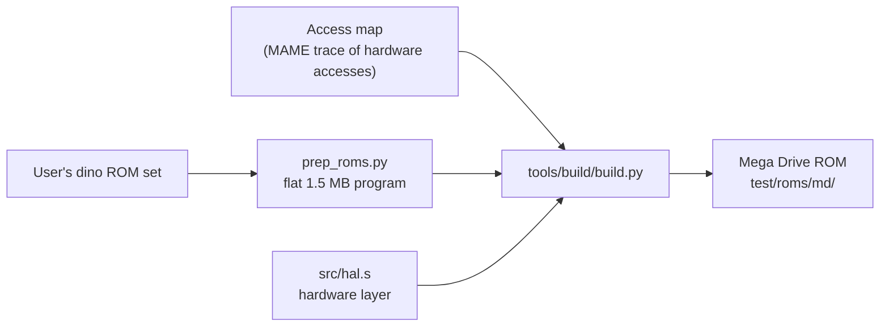

# Port plan

How *Cadillacs and Dinosaurs* gets from the arcade board to a Mega Drive cartridge, in milestones. It builds on the measurements in [doc 01](01-architecture-cps1-vs-mega-drive.md), [doc 02](02-final-fight-arcade-vs-md.md) and [doc 03](03-cadillacs-and-dinosaurs-measured.md).

## Decisions

| Decision | Choice | Why |
|---|---|---|
| Game code | Capcom's original 68000 program, run in place | Same CPU, same RAM address; logic is then identical by construction. Its real work fits half a Mega Drive frame in steady play |
| New code | 68000 assembly, GNU binutils (`m68k-elf-as`, `m68k-elf-ld`) | The arcade code has fixed register roles, its own kernel and interrupt handler; a C runtime such as SGDK would fight all three |
| Game data | Taken from the user's ROM set at build time | The repository holds no Capcom data; built ROMs are never committed |
| Reference for video | Final Fight MD's recipe (doc 02) | Proven layer mapping, palette plan, sprite cutting and VRAM layout |
| Emulator for checks | MAME `genesis`, headless | Scriptable; BlastEm for hands-on play |

vasm was the first choice of assembler; GNU binutils is used because it installs from Homebrew.

## How the build works



`tools/build/build.py` takes the arcade program and:

1. **Redirects fixed-address hardware accesses** to shadow locations in work RAM by rewriting the address operand in place (same instruction, same size): the I/O and video registers at `0x800000`, the sound interface at `0xF18000`, and player 3 and EEPROM at `0xF1C000`. It patches the instructions seen executing in the access map, then any remaining value in those ranges that is the operand of a valid instruction.
2. **Replaces the vector table and the first header page.** Reset and VBlank (level 6) go to the hardware layer; TRAP vectors stay Capcom's, so the kernel runs unchanged.
3. **Skips the power-on self-test**, which reads back arcade video RAM, and enters the game's start-up directly.
4. **Appends the hardware layer** after the program at `0x180000`.

The hardware layer (`src/hal.s`) boots the console, and on every VBlank fills the shadow input ports from the pad and then jumps into Capcom's own VBlank handler.

### Memory

| Arcade | Mega Drive build |
|---|---|
| Program `0x000000–0x17FFFF` | Same addresses |
| Work RAM `0xFF0000–0xFFFFFF` | Same addresses |
| I/O and video registers `0x800000–0x8001FF` | Shadow at `0xFF1000` |
| Sound interface `0xF18000–0xF1803F` | Shadow at `0xFF1200` |
| Player 3, EEPROM `0xF1C000–0xF1C01F` | Shadow at `0xFF1280` |
| Sprite lists `0x900000`, `0x904000` | RAM buffers at `0xFF2000`, `0xFF2800` |
| Palettes and row scroll `0x914000–0x917FFF` | RAM at `0xFF3000–0xFF6FFF` |
| Tilemaps `0x908000–0x913FFF` and the rest of GFX RAM | Not handled yet (milestone 3) |
| Hardware layer's own data | `0xFF12C0`, `0xFF7000–0xFF77FF` |

Measured over stage 1, the game writes 41% of its work RAM after boot and leaves one block of about 28 KB untouched (`0xFF0FD3–0xFF7FFF`). The shadows live there. The game's start-up does clear that block once, so anything the hardware layer keeps there is re-established every frame. Whether later stages use the block is not yet measured.

`0xF18000` matters on real hardware: the Mega Drive mirrors work RAM through `0xE00000–0xFFFFFF`, so an unpatched sound write would land in the game's own variables.

## Milestones

### 1. The arcade program runs on the Mega Drive — done (emulator)

Verified in MAME's Mega Drive driver by reading the game's own state:

- The task kernel runs: same task slots and the same call stacks as the arcade machine at the same point (attract mode, with the polling task in slot 15).
- VBlank drives Capcom's handler, which writes its video registers to the shadow (sprite buffer flipping, scroll positions, layer control changing between scenes).
- Pad input works end to end: A inserts a coin, Start starts, the game enters stage 1, player 1 becomes active, and holding right moves him and scrolls the stage; the enemy update loop runs.

Not done in this milestone: any picture or sound, GFX RAM (writes go nowhere, reads return nothing useful), and safety on real hardware (unpatched GFX RAM accesses would hang a real console).

### 2. Sprites

- **Done (emulator):** the sprite list builder (`0x13FA6`) and the list-clearing routine write to two RAM buffers at `0xFF2000` and `0xFF2800` in place of arcade video RAM (four address operands).
- **Done (emulator):** outlines, as a first check of positions, sizes and order.
- **Done (emulator): real sprite graphics.** The title logo, the attract-mode story (portraits, the Cadillac, the raptor), the character select, and stage 1 through to the mansion interior show Capcom's sprite art with correct colours.

How it works:

- **Build time.** Every arcade 16×16 tile in the sprite range is converted to four Mega Drive patterns (pen 15, transparent on the CPS-1, becomes pen 0). A byte per tile records whether it has any pixels. Colour levels are precomputed into a 256-byte table from MAME's brightness formula.
- **Graphics ROM layout.** The arcade graphics ROM is organised by use: tile codes `0x0000–0x07FF` text layer, `0x0800–0x57FF` sprites, `0x5800–0x6FFF` playfield tiles (some also used as sprites), `0x7000–0x7FFF` far background (stage 1 trace). Only `0x0800–0x6FFF` is stored for now: 3.25 MB, giving a 4.8 MB ROM.
- **Per frame**, after Capcom's VBlank handler shows a finished list, the hardware layer walks it once:
  - cuts each block into pieces of two tiles side by side (32×16) where the two tiles are consecutive in ROM, otherwise single tiles (16×16), honouring the block's flips;
  - looks each piece up in a 128-slot, 4-way VRAM cache (1,024 patterns) and queues a DMA from ROM for misses, at most 22 per frame;
  - writes the Mega Drive sprite table in the arcade's order, so the arcade's front-most sprites stay in front;
  - picks the four sprite palettes used by the most tiles, converts them to Mega Drive colours, and sends sprites in other palettes through the first line.
- **Next VBlank** it sends the queued tiles, the sprite table and the palettes.
- **The work only happens when the game has finished a new list.** Processing an unterminated list of 256 entries took more than a frame.

Measured in MAME over 100 seconds of attract mode and stage 1 (6,000 frames with sprites):

| Per frame | mean | p50 | p95 | max |
|---|---|---|---|---|
| Hardware sprites | 48 | 46 | 69 | 80 (cap reached in 2.3% of frames) |
| VRAM DMA, bytes | 565 | 448 | 1,696 | 5,760 |
| Colours in CRAM | 44 | 47 | 50 | 51 |

Known problems:

- **Per-line limits.** 30% of frames have a line with more than 320 sprite pixels or 20 sprites, where the VDP drops the pieces latest in the list. The title logo loses letters this way.
- **Palettes.** Sprites outside the four busiest palettes use the wrong colours.
- **VBlank can arrive late.** The arcade kernel raises the interrupt mask to level 6 to shut out its own level-2 VBlank; on the Mega Drive that also delays our level-6 VBlank, and in 2.5% of frames the uploads start after the picture has begun.

Still to do in this milestone:

- Replace the builder with one that writes the Mega Drive sprite table directly (a quarter of the game's CPU work).
- Overflow rules: rotation (flicker) when a line or the 80-sprite total overflows; 32×32 pieces to halve the sprite count.

### 3. Backgrounds and palettes

**Done (emulator): the playfield (scroll 2) on plane B.** The character select artwork, the stage 1 intro scene, and the rooftop floor and walls scroll with the camera under the sprites. The game finishes 51 to 60 sprite lists a second in stage 1 (measured over 50 seconds of scripted play).

What the measurements showed and how it works:

- **The game does not write maps locally.** It fills whole maps at scene changes and prepares columns half a map (32 columns) ahead of the camera, so the planes cannot be fed as it writes. The playfield is kept in a RAM store of 64 columns × 32 rows (8 KB, arcade rows taken mod 32) and drawn from it.
- **The game reads the playfield map back** for floor zones and collision (the top six bits of each attribute word, read by `0x1309C` and `0x1361E`); those reads are served from the store.
- **Plane B is a ring** of 32 arcade columns × 16 rows that follows the camera: a new column is drawn as the camera crosses a column boundary, and a jump of more than 8 columns redraws the ring.
- **Playfield tiles go through a reference-counted VRAM cache** of 200 slots (800 patterns), keyed by tile code in a 512-entry hash table, filled from ROM by CPU copy as cells are drawn.
- **Writes reach the store in three ways:**
  - 122 instructions that touch the playfield through pointers are replaced by `TRAP #8`. The handler looks the instruction up in a build-time hash table, decodes it (MOVE, CLR, AND, OR, any addressing mode) and performs it, sending accesses to arcade video RAM to the store.
  - Three heavy routines (the table clear at `0xBA0`, the 2 × 2 block writer, the long copier) get dedicated traps (#9 to #11).
  - 210 instructions that only touch layers not drawn yet (HUD text, far background) are reduced at build time to their register side effects (`addq` for address increments, a cleared register for reads). The routine at `0xA7B8`, which only fills a table the port drops, returns immediately.
- **The hardware layer runs on its own stack** at `0xFF19A0–0xFF1FFF`. The arcade's supervisor stack (`0xFF0E66`) sits directly above its task stacks and has no room: nesting the trap handler, VBlank and Capcom's VBlank handler overwrote a task's return address.
- **Line 2 of CRAM** carries the playfield palette used most on screen (sampled every 32 frames); sprites use lines 0, 1 and 3.

The instruction budget is the hard constraint. The Mega Drive's 68000 executes about 13,000 instructions per frame. Measured with MAME's instruction trace on the select screen before these changes, the sprite converter used about 9,500 of them, a trap cost about 170, and Capcom's code got 2%. After them, in stage 1, Capcom's code gets 58%. To get there:

- the sprite converter keeps its loop values in registers and runs on even frames only;
- palette colours are converted only when their arcade value changes;
- trap lookups use a hash table.

Still to do:

- The far background (scroll 3) on plane A, and the HUD (scroll 1) in the window. Their writes are currently dropped.
- Palettes: one CRAM line per layer gives wrong colours for tiles in other palettes; per-scene palette plans made offline (16 arcade palettes into 4).
- Sprites at 60 Hz again, by replacing Capcom's sprite list builder instead of converting its output.
- A one-frame vertical move of the camera redraws the whole ring; stages that scroll vertically need column and row streaming.

### 4. Sound

- Take over the sound command queue (one routine in the VBlank handler).
- Z80 driver with FM music re-arranged from the QSound sequences and PCM effects.

### 5. Real hardware

- Every GFX RAM access patched or redirected, with the access map extended to all stages.
- Sega mapper for the ROM beyond 4 MB; settings in battery RAM in place of the EEPROM.
- Run the polling task once per frame.
- Checks in BlastEm and on a console.

### 6. Whole game

- Traces and tuning for every stage, three players through a multitap, the slow bursts at scene changes.

## Open problems

- **Where the tilemaps live.** Scroll 1 and scroll 3 are 16 KB each and do not fit beside the game in work RAM. The plan is to translate their writes straight into VRAM, which means understanding the 330 or so instructions that write them through pointers.
- **The access map is incomplete.** It comes from one stage-1 play-through, and it missed at least one start-up instruction that reads a DIP switch (found only when the Mega Drive build went into test mode). Static patching covers that case; code that reaches hardware through pointers in unvisited stages is still unknown.
- **Free RAM across the whole game.** The 28 KB block is a stage-1 result.
- **CPU bursts.** Whether the saturated moments are all non-interactive.

## Trying a build

Built ROMs go to `test/roms/md/`, which git ignores because they contain the user's game program. Build with:

```sh
analysis/venv/bin/python3 -I tools/build/build.py analysis/work/dino_prg.bin analysis/work/dino_gfx.bin \
  analysis/mame/dino_access/access_pcs.csv test/roms/md/cadillacs_md.md
tools/run_md.sh test/roms/md/cadillacs_md.md analysis/mame/run      # MAME with the mapper, in a window
TRACE_INPUT=arcade tools/check_md.sh test/roms/md/cadillacs_md.md analysis/mame/check 7200 600
```

Pad: A = coin, Start = start, B = attack, C = jump.

The ROM is 6 MB and uses the Sega/Krikzz SSF mapper, which its header announces (`SEGA SSF`). MAME enables bank switching only for a software-list entry: `tools/run_md.sh` writes one with slot type `rom_titan` (the Krikzz SSF mapper, 32 banks); MAME 0.289's `rom_ssf2` type implements only the 10 banks Super Street Fighter II used. Other emulators and flash carts read the header.

The current build shows the sprites and the playfield. The far background is black, and there is no HUD or sound. The game runs close to full speed; sprites animate at 30 Hz. It has been run in MAME's Mega Drive driver only. Do not run it on a real console or flash cart yet: it still writes to arcade tilemap addresses, which a real Mega Drive does not tolerate.
